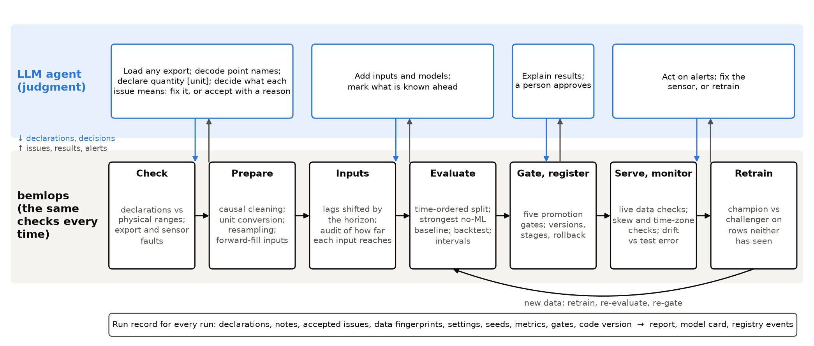
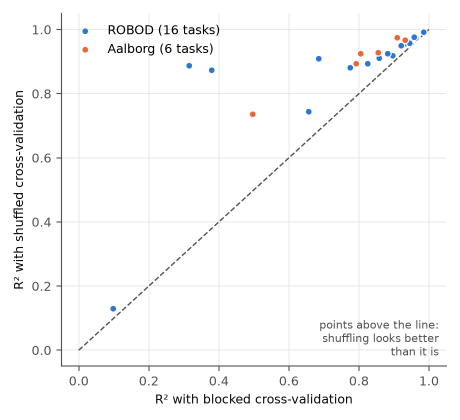
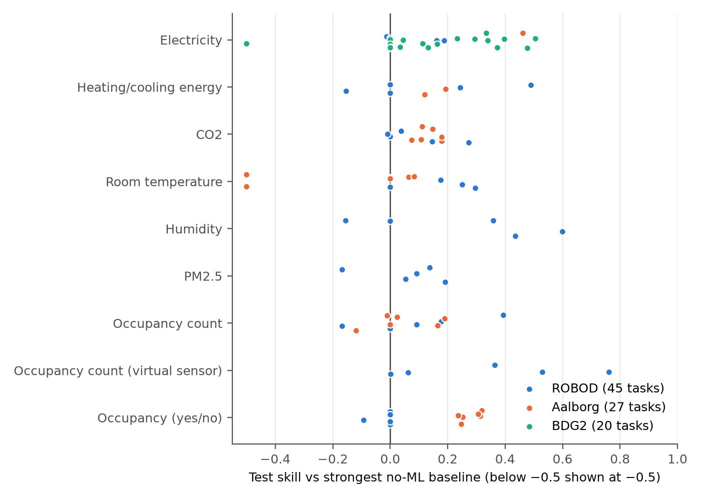
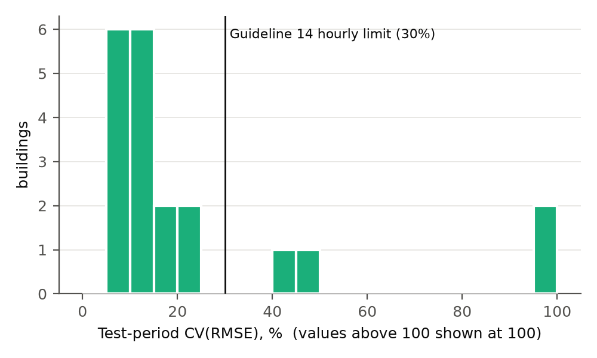
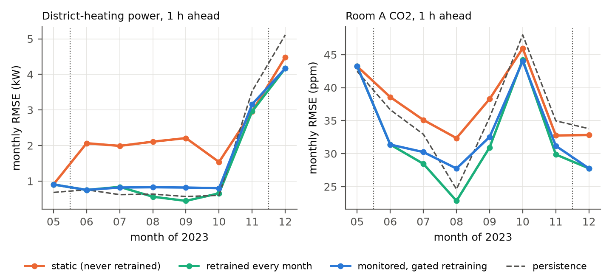

# Where domain guardrails matter for LLM-agent-built prediction models in buildings: an open MLOps framework evaluated on real data

*Draft manuscript, version 2 of the work first reported in arXiv:2407.03469. Author list and affiliations to be confirmed by the authors.*

**Keywords:** building energy; indoor environmental quality; occupancy; machine learning operations (MLOps); large language model agents; data quality; time-series evaluation

## Highlights

- An LLM agent reads messy building data; a domain package applies fixed checks.
- On 92 real-building tasks, ML beat the strongest simple rule in about half.
- A random split understated forecast error by a median 27% on the same rows.
- Monitoring beat a static model, but scheduled retraining did better still.
- Capable agents built equally good models with or without the framework.

## Abstract

Large language model (LLM) agents can now write the code for building
prediction models; whether those models can be relied on depends on what
surrounds the code. We present bemlops, an open-source framework in which an
agent supplies building-specific judgment (reading exports, decoding point
names, declaring physical quantities and units) and a domain package applies
the same checks every time: physical plausibility, causal cleaning, inputs
that cannot reach past the forecast time, time-ordered evaluation against the
strongest no-ML baseline, promotion gates, monitoring and retraining. We
evaluated it on 92 tasks in three public real-building datasets (energy,
thermal load, temperature, CO2, humidity, PM2.5, occupancy) and in a
formative pilot with eight independent agent runs. Ordinary models beat the
strongest simple rule significantly in 52% of tasks, and 45% failed the
promotion gates. A random split, the protocol of our 2024 study, understated
error by a median of 27% on the same rows. With planted faults, the
framework reproduced clean-data accuracy, whereas a quick script was 9% worse
in mean absolute error, though not in RMSE. Over eight months, monitoring
with gated retraining cut error by 10–33% against a static model, but monthly
retraining did better and persistence matched it for district heating.
Independent agents told to be rigorous built equally accurate, leak-free
models with or without the framework, at higher cost with it, and found a
dead meter our own agent had missed. The framework's value lies in making
rigorous evaluation the default, in comparable records and in the operating
lifecycle, not in out-modeling a capable agent.

## 1. Introduction

Buildings account for about 30% of global final energy use [IEA 2023], and
data-driven prediction sits behind many of the ways that use is managed in
operation:
- model predictive control needs load and temperature forecasts;
- demand response needs hour-ahead power forecasts;
- fault detection needs expected values to compare against;
- indoor-environment management needs to know where CO2 or temperature is heading.

Machine-learning models for these tasks are well studied [Amasyali and
El-Gohary 2018]. They are rarely deployed at scale, because each building needs
its own model, and building one takes a data scientist days of work on data
that is different every time. Point names such as `RM204_ZN_T` or `AI-3.PV`
must be decoded. Units are mixed. Exports contain text in number columns,
placeholder values, stuck sensors and gaps, in formats that vary by vendor.

Our preliminary study [Khadka and Zhang 2024] asked whether large language
models (LLMs) could remove that bottleneck by writing the modeling code. A
prompt template following the steps of a machine-learning operations (MLOps)
lifecycle let GPT-4 produce runnable code for a simulated small office in 34 of
35 attempts. Three problems limit what that result means:
- code that runs is not the same as a model that is right;
- the generated pipelines split the time series at random and selected features
  on the full dataset, both of which can let test information leak into
  training [Bergmeir and Benítez 2012; Kapoor and Narayanan 2023];
- the study used one simulated building and stopped before deployment.

LLM agents have since become able to write and run analysis code on their own,
so generating a modeling script is no longer the hard part. The open question
is when such a model can be relied on in operation, and what has to surround
the agent's code for that. This paper studies one answer, a division of labour:
- **The agent** reads whatever export it is given, works out what the points
  mean, and makes the judgment calls that no fixed pipeline anticipates.
- **A domain package** applies checks that are the same every time:
  - every declared column is checked against physical plausibility;
  - inputs are built so that they cannot reach past the forecast time;
  - every model is evaluated in time order against the strongest simple
    baseline;
  - promotion to production is gated;
  - deployed models are monitored and retrained;
  - every decision is recorded.

We call these checks guardrails, in the software-engineering sense of checks
that a workflow passes through, not in the sense of LLM output filtering. We
ask five questions, one per experiment:

- **RQ1.** Can one agent-plus-guardrails workflow produce defensible models
  across the targets that matter in buildings (energy, thermal load,
  temperature, CO2, humidity, particulates, occupancy) and across many
  buildings? How often does machine learning beat the strongest simple rule?
- **RQ2.** How much does the evaluation protocol of the 2024 study (a random
  split) change the reported error on real building data?
- **RQ3.** Which data faults do the checks detect on real data, and what does
  automatic handling buy compared with a quick script given the same fix?
- **RQ4.** Over months of operation, does monitoring with gated retraining
  beat a static model, persistence, and naive scheduled retraining?
- **RQ5.** Does the framework change what independent LLM agents deliver?

The contributions are:
1. **A framework** for building prediction that divides work between an agent
   and domain guardrails, covering the MLOps lifecycle from data validation to
   monitoring and retraining. It is mapped to the nine principles of
   Kreuzberger et al. [2023]. Its building-specific parts are:
   - physical-quantity declarations with unit inference as the interface
     between agent and package;
   - fault semantics of building automation systems (BAS): change-of-value
     logging, equipment idling, sensor floors;
   - gates based on the strongest no-ML baseline and ASHRAE Guideline 14.
2. **An open-source implementation**, `bemlops`, with an Agent Skill that
   teaches LLM agents the workflow. It handles any numeric or yes/no target.
3. **An evaluation on three public real-building datasets**: 72 tasks in 11
   rooms and their building systems, plus a 20-building portfolio, answering
   RQ1–RQ4.
4. **A formative pilot with eight independent agent runs**, answering RQ5. It
   found no accuracy, leakage or fault-finding advantage from the framework for
   capable agents told to be rigorous, at a higher cost in tokens and time. The
   framework's measured value therefore lies elsewhere: in default rigour, in
   comparable and maintainable records, and in the lifecycle. The pilot agents
   also exposed defects that were then fixed.

All code, configurations, run records and pilot deliverables are public
(https://github.com/TensorBuildLab/MLOps-building-energy-and-environment-prediction).

## 2. Related work

### 2.1 Data-driven prediction in buildings

Machine-learning models of building energy use are well established
[Amasyali and El-Gohary 2018] and are a standard ingredient of data-driven
control [Maddalena et al. 2020]. Indoor environment and occupancy are
predicted with the same tools: occupancy from light, temperature, humidity
and CO2 [Candanedo and Feldheim 2016], and indoor CO2 a few hours ahead from
a year of office data [Kallio et al. 2021]. Large benchmarks exist for load
forecasting [Emami et al. 2023; Miller et al. 2020]. What remains expensive is
the work around each model: understanding a new building's data, cleaning it,
and evaluating and maintaining the model. Reviews of preprocessing for
building operational data [Fan et al. 2021] and of fault detection [Kim and
Katipamula 2018] show how much of that work concerns faulty sensors and data
problems rather than modeling.

### 2.2 Automated and LLM-generated pipelines for buildings

Automated machine learning (AutoML) has been benchmarked for building load
prediction [Zhang et al. 2023], and an end-to-end automated forecasting
framework covering preprocessing, feature engineering and model selection
has been proposed [Zhang et al. 2024a]. Since 2023, LLMs have been used to
generate data-mining code for building energy management [Zhang et al. 2024b],
to automate load-prediction pipelines end to end [Zhang et al. 2025b], to
analyse unstructured building data with multiple agents [Xiao and Xu 2024],
and to coordinate specialist agents with many tools for building operations
[Jiang et al. 2026]. Our preliminary study used MLOps-structured prompt
templates to have an LLM write modeling code [Khadka and Zhang 2024]. These
studies mostly evaluate whether generated code runs, how accurate the
resulting model is on a held-out split, or whether tools are selected
correctly. They leave two questions largely open: how to make an agent's
result on real, messy data checkable, and how to operate the resulting
models over time.

### 2.3 Agents for machine-learning engineering

Outside buildings, agents that interleave reasoning with tool use [Yao et al.
2023] are evaluated on machine-learning engineering tasks: MLAgentBench
[Huang et al. 2024] and MLE-bench [Chan et al. 2025] score agents on curated
tasks against held-out test sets that the benchmark controls, and DS-Agent
[Guo et al. 2024] reuses past solutions to plan data-science pipelines. In
these settings the benchmark, not the agent, guarantees a sound evaluation.
In a building, nobody holds back a clean test set: the agent's own split,
cleaning and baseline decide whether the reported accuracy means anything.

### 2.4 MLOps tools and evaluation pitfalls

Machine-learning systems accumulate hidden technical debt [Sculley et al.
2015]. Production readiness can be scored with test rubrics [Breck et al.
2017], and data should be validated as rigorously as code [Breck et al.
2019]. Kreuzberger et al. [2023] synthesise MLOps into nine principles and
nine components, which we use as a checklist. Mature general-purpose tools
cover parts of this lifecycle (Table 1):
- data validation: Deequ [Schelter et al. 2018], Great Expectations [Gong and
  Campbell 2026] and pandera [Bantilan 2020];
- experiment tracking, versioning and model registries: MLflow [Zaharia et al.
  2018] and DVC [Kuprieiev et al. 2026];
- drift monitoring: Evidently [Evidently AI 2026];
- time-series learning with backtesting and naive forecasters: sktime [Löning
  et al. 2019], Darts [Herzen et al. 2022] and AutoGluon–TimeSeries [Shchur et
  al. 2023].

Darts, for example, separates past from future covariates, which prevents one
form of look-ahead. Model cards document a model's intended use and
evaluation [Mitchell et al. 2019]. On evaluation, cross-validation for time
series must respect temporal dependence [Bergmeir and Benítez 2012]. Data
leakage, including leakage from random splits and from preprocessing on the
full dataset, is a leading cause of irreproducible machine-learning results
across sciences [Kapoor and Narayanan 2023].

**Table 1.** What existing tools provide and what this work adds. "Partly":
possible with rules or configuration the user writes; "n.r.": not reported.

| Capability | Data validation (Deequ, Great Expectations, pandera) | Tracking and registries (MLflow, DVC) | Monitoring (Evidently) | Time-series ML (sktime, Darts, AutoGluon–TS) | Building AutoML / LLM pipelines [Zhang et al. 2023, 2024a, 2025b] | This work |
|---|---|---|---|---|---|---|
| Physical-quantity declarations with unit inference | no | no | no | no | n.r. | yes |
| BAS sensor-fault semantics (stuck vs change-of-value logging, idle equipment, sensor floors) | partly | no | no | no | n.r. | yes |
| Generic schema and range checks | yes | no | partly | no | partly | yes |
| Inputs that cannot reach past the forecast time, with an audit | no | no | no | partly | n.r. | yes |
| Time-ordered evaluation and backtesting | no | no | no | yes | n.r. | yes |
| Strongest no-ML baseline as the reference, and as a promotion gate | no | no | no | partly | no | yes |
| Model registry with gated promotion and rollback | no | yes | no | no | no | yes |
| Drift and live-data monitoring | partly | no | yes | no | no | yes |
| Written for an LLM agent to drive (declarations, skill file) | no | no | no | no | partly | yes |

None of the building-specific rows is technically difficult. The point of
this work is that they are combined behind one small interface that an agent
can use, and measured on real buildings.

### 2.5 Metadata

Brick [Balaji et al. 2016] standardises building metadata, and with it the
meaning of points. Where a Brick model exists, it can supply the declarations
our framework requires, and each quantity in the framework names its nearest
Brick class for this reason. Most real exports, including the three datasets
used here, carry no such model, so the agent infers declarations from names,
documentation and values.

### 2.6 What we mean by a guardrail

In the LLM-safety literature a guardrail filters a model's inputs or outputs.
We use the word in its software-engineering sense: a check that every run of
a workflow passes through, with a defined outcome (block, warn, mask, refuse
promotion) and a record of the result. The guardrails here are written in
ordinary code. They constrain what reaches a model and what reaches
production, not what the agent may write. An agent can bypass them: two pilot
agents replaced the package's model with their own (Section 6.5). The
guardrails then cover only the part of the work that went through the
package.

## 3. Framework

This section describes the version used for every result in Section 6
(package version 0.2.0.dev0, source fingerprint `f394d2e9ee9047c8`). Changes
made after the experiments are listed in Appendix A and are not evaluated.

### 3.1 Division of labour

Figure 1 and Table 2 show who does what. The agent may write any code it
needs. The package accepts any table with a time index and does not limit
what the agent does before handing data over. It controls what happens after
that point:
- nothing reaches a model unless it has been declared, checked and prepared
  in a logged, deterministic way;
- nothing reaches production unless it has passed explicit gates.



**Table 2.** Division of labour.

| The agent (judgment) | The package (checks that are the same every time) |
|---|---|
| Clarify target, horizon and use with the person who asked | Refuse to fit while data errors are unresolved |
| Load any export format | Accept any table with a time index |
| Decode point names; declare quantity and unit | Check every declaration against physical ranges; name the likely unit when it is wrong |
| Decide what faults and unusual periods mean | Detect stuck sensors, spikes, placeholder values, text, duplicates, gaps, cumulative meters |
| Design extra inputs; mark what is known in advance | Shift every measured input by the horizon; audit how far each input reaches |
| Add own models if needed | Evaluate every model the same way: time-ordered, against the strongest no-ML baseline |
| Explain the results | Report, model card, gates, registry, monitoring; one record per run |

### 3.2 Declarations as the interface

The interface between the agent and the package is a **declaration**. For
each column the agent wants to use, it states a physical quantity (zone air
temperature, electric power, CO2, occupancy status, and so on) and a unit,
for example `"zone_air_temperature [degF]"`. Point names are ambiguous and
vendor-specific; a declaration is explicit and can be checked.

Each quantity carries:
- a canonical unit and conversions;
- a physically plausible range, and a narrower typical range used to infer
  the most likely unit when the declared one does not fit;
- behavioural flags. For example, setpoints may stay constant for days,
  solar irradiance is zero all night, and an idle meter may sit at zero.

Two shorthand flags let the agent record knowledge the package cannot infer:
- `flat_ok`: long flat stretches are normal for this sensor, for example a
  CO2 sensor floor;
- `known_ahead`: the value is known at forecast time, for example a schedule
  or a weather forecast.

Only declared columns are used. The target's quantity fixes the task type:
numeric quantities give regression tasks, and yes/no quantities (occupancy
status, equipment status) give classification tasks. The evaluated version
has 24 quantities, including a generic `other` for inputs without physical
checks.

### 3.3 Data checks and preparation

Issues have three severities:
- **Errors** block fitting until the agent fixes the data or the declaration,
  or accepts the issue with a written reason. Examples: a unit that does not
  fit the values, a unit that changes part-way through a series, a quantity
  that fits in no unit, a cumulative meter declared as interval energy,
  decimal commas, an empty target.
- **Warnings** are handled by the standard preparation step, which logs every
  action. Examples: stuck sensors, spikes, placeholder values, text entries,
  duplicates, rows out of order, gaps.
- **Information** covers everything else.

Preparation proceeds in this order:
1. Rows are sorted and de-duplicated, and text is converted or set missing.
2. Units are converted to canonical units.
3. Placeholder values and physically impossible readings are set missing.
4. Stuck stretches and spikes are set missing.
5. The data are resampled to a regular grid.

Cleaning is **causal**: a decision about a reading uses only that reading and
earlier ones. A spike is judged against the median of the four preceding
readings. A stretch of identical values is masked only from the point at
which it has lasted long enough to be detected (6 h by default), not from its
start. Stretches never span a gap in the data. An interval total, such as
energy per 15 minutes, is computed only when every reading in the interval is
present. Inputs are filled forward only, up to a limit, because interpolation
uses values a live system does not yet have. The target is never filled.

### 3.4 Inputs that cannot reach past the forecast time

For a forecast *h* steps ahead, the prediction for interval *T* uses measured
data from intervals up to *T* − *h* only. Target lags, rolling means and
measured inputs are shifted accordingly. Only inputs declared `known_ahead`
may be used at *T*. Every input records how far back it reaches, and an audit
refuses any input that reaches forward. Inputs whose correlation with the
target exceeds 0.995 are flagged as possible copies of it. In estimation mode
(*h* = 0), the target is estimated from other inputs at the same moment, as a
virtual sensor, and never appears among its own inputs. Day-of-year inputs
are added only when the training data cover a full year.

### 3.5 Evaluation

There is no random split.
- **Split.** Data are split in time order into training, validation and test
  sets (70/15/15 by default), with a gap of *h* steps between them.
- **Tuning.** Hyperparameters are tuned by random search with time-ordered
  cross-validation on the training set only.
- **Baselines.** Every task includes no-ML baselines:
  - for forecasts: persistence (the latest known value), the value at the same
    time the day before, and a time-of-day profile (the training mean for each
    time of day, separately for weekdays and weekends);
  - for estimates: the training mean, or the share of "yes".
- **Reference.** The strongest baseline on validation becomes the reference
  for that task.
- **Candidates.** For regression: ridge regression, a random forest, gradient
  boosting, and gradient boosting on the change from the latest known value
  (`gbm_change`). For classification: logistic regression, a random forest
  and gradient boosting. The agent can add its own.
- **Choice.** The candidate or baseline with the lowest validation error is
  chosen, even when it is a baseline.
- **Test.** The chosen model and the reference are refitted on training plus
  validation data and scored once on the test set.

Accuracy is reported as skill against the reference: one minus the ratio of
root-mean-square errors (RMSE), or of Brier scores [Brier 1950] for yes/no
targets. This is not the more common MSE skill score. An RMSE skill of 0.05
corresponds to an MSE skill of about 0.10.

The record also contains:
- errors in physical units;
- for energy-like targets, the ASHRAE Guideline 14 hourly criteria
  (CV(RMSE) ≤ 30% and |NMBE| ≤ 10%) [ASHRAE 2014]. They are computed on the
  test-set predictions aggregated to hours (hourly totals for energy, hourly
  means for power), so a 15-minute model is judged on hourly values;
- a rolling-origin backtest: the period after training is cut into three
  blocks, and before each block the chosen configuration is refitted on all
  earlier data. The backtest overlaps the validation period that chose the
  model, so it is a check on stability, not an independent test;
- a 90% prediction interval. Its half-width is the 90th percentile of the
  absolute validation errors of the chosen model (trained on the training
  set only), in the manner of split conformal prediction. Its coverage is
  reported on the test set;
- grouped permutation importance of the inputs.

### 3.6 Promotion gates

A model reaches production only through a registry, which evaluates five
gates from the run record:
- every data error is resolved or accepted;
- test skill is at least 0.05;
- Guideline 14 is met, where it applies;
- no input is flagged as a possible copy of the target or as reaching
  forward;
- the test set has at least 200 rows.

The gates use the single test window, not the backtest. Overriding a gate
requires a written reason and is logged. Accepted issues from earlier runs
never approve errors on new data.

### 3.7 Monitoring and continuous training

Every live prediction does three things:
- re-runs the data checks;
- rebuilds every trained input with the training code;
- checks that the live time zone matches training.

A drift check on recent data recommends retraining in either of two cases:
- the recent primary error exceeds 1.5 times the test-time error;
- more than 20% of an input's recent values fall outside its training range,
  widened by 10% on each side.

The drift check also reports new sensor faults. It separates problems that
retraining can fix from those it cannot.

Retraining reuses the production configuration on newer data. The champion
and the challenger are scored on rows that start after both training periods
plus the horizon. The challenger is promoted only if it passes the gates and
has the lower error.

### 3.8 MLOps coverage

Table 3 maps the framework to the nine MLOps principles of Kreuzberger et al.
[2023]. Two components of their reference architecture are deliberately
absent:
- **A shared feature store.** Features are rebuilt from the declared
  configuration by the same code in training and serving. At single-building
  scale this removes the training-serving skew that a feature store guards
  against.
- **An online serving endpoint.** Serving is batch or scheduled; a web service
  would be a thin wrapper.

**Table 3.** MLOps principles [Kreuzberger et al. 2023] and their implementation.

| Principle | Implementation |
|---|---|
| P1 CI/CD automation | Tests, including end-to-end model tests, run on every commit; models are delivered through gated promotion |
| P2 Workflow orchestration | `train`, `retrain` and `reproduce` pipelines and a command-line interface with exit codes, for any scheduler |
| P3 Reproducibility | Configuration, declarations, notes, seeds, library versions, code commit, package fingerprint and data fingerprints in every run record; `reproduce` re-runs a record and checks that every metric matches |
| P4 Versioning | Code commit and package fingerprint; numbered model versions; data fingerprints |
| P5 Collaboration | Report and model card per run; decisions and accepted issues recorded with reasons |
| P6 Continuous training and evaluation | Champion/challenger retraining on rows neither model has seen |
| P7 Metadata tracking | Run records and a registry event log |
| P8 Continuous monitoring | Live data validation, training-serving comparison, drift and fault monitoring |
| P9 Feedback loops | Monitoring recommends retraining; data checks feed back to the agent |

Reproducibility here means re-executing the agent's frozen decisions (its
declarations, notes and accepted issues), not re-running the agent, which is
not deterministic.

### 3.9 The agent's instructions

The agent learns the workflow from an Agent Skill [Zhang et al. 2025a]: a
short instruction file loaded on demand. It contains:
- **the workflow:** clarify the task, inspect and load the data, declare
  columns, resolve every check, prepare, fit, report, register, monitor;
- **seven rules,** for example: never split building time series at random,
  never declare a measured value as known in advance, never change a
  declaration to silence a check;
- **a playbook** for messy data;
- **a reference** for decoding point names in building automation systems.

The skill is the successor of the 2024 prompt template. Instead of
prescribing code, it prescribes conduct.

## 4. Implementation

`bemlops` is a Python package (BSD 3-Clause licence) built on pandas and
scikit-learn. Table 4 lists its modules. A typical session takes about a
dozen lines:

```python
p = bemlops.Project(df, target="AHU1_CLG_KW", horizon="1h", tz="America/Phoenix", columns={
        "AHU1_CLG_KW": "electric_power [kW]",
        "OAT": "outdoor_air_temperature [degF]",
        "RM204_ZN_T": "zone_air_temperature [degF]", ...})
print(p.check_data())          # issues, with severities and suggested fixes
p.prepare(freq="15min")        # logged, causal standard preparation
results = p.fit()              # baselines + tuned models, time-ordered, backtest, intervals
folder = p.save_run("runs/")   # record, report, model card, model
reg = bemlops.Registry("models/")
reg.promote(p.name, reg.register(folder)["version"], reason="...")  # gates checked here
```

**Table 4.** Package modules (evaluated version 0.2.0.dev0; release 0.2.0 has 28 quantities).

| Module | Role |
|---|---|
| `quantities`, `schema` | 24 physical quantities with units, conversions, plausible and typical ranges, and flags; parsing of declarations |
| `cleaning`, `checks` | Causal detectors for export and sensor problems; the data report with blocking errors |
| `prepare` | Logged standard preparation and resampling |
| `features`, `split` | Inputs shifted by the horizon, with an audit; time-ordered splits with a gap |
| `models`, `metrics` | Baselines (persistence, same time yesterday, time-of-day profile, mean, share of ones) and tuned candidates; RMSE, MAE, CV(RMSE), NMBE, Guideline 14, Brier score, accuracy, balanced accuracy, F1, ROC AUC |
| `project` | The workflow, its configuration, backtest, intervals and input drivers |
| `report`, `governance` | Run record, report, model card; promotion gates |
| `deploy`, `registry`, `pipeline`, `cli` | Deployable model with live validation and drift checks; registry with stages, champion/challenger and rollback; scheduled pipelines; command line |

The candidate models are deliberately conventional, and the hyperparameter
searches in the case studies are small (3–6 settings per model). The
framework's claims concern the process around the model, not the model
family. A model can be added through a `custom_models` argument in a few
lines.

The evaluated version has 45 automated tests (48 in release 0.2.0). They
include:
- a test that perturbs every value after the forecast time and checks that no
  input changes;
- tests that every planted fault in a synthetic export is detected;
- regression tests for the defects in Appendix A;
- tests of the full registry, retraining and reproduction loop.

Every run record carries:
- the git commit of the case-study code;
- a fingerprint of the package source, so that runs made at different case-study
  commits can be shown to use identical package code.

## 5. Study design

### 5.1 Data

We chose three public datasets of measured data (Table 5). Together they
cover many prediction targets, three climates, different levels of data
quality, and a building portfolio. All three can be downloaded by a script
without an account, and the script verifies checksums, so every result can
be reproduced from the repository. Raw data are not redistributed.

We reviewed a fourth dataset, the three-year LBNL Building 59 record [Luo et
al. 2022], and left it out because its repository does not allow scripted
download.

**Table 5.** Datasets.

| | ROBOD [Tekler et al. 2022] | Aalborg offices [Melgaard et al. 2024] | BDG2 [Miller et al. 2020] |
|---|---|---|---|
| Location, climate | Singapore; tropical | Aalborg, Denmark; temperate | 16 sites in North America and Europe |
| Buildings / spaces | 5 rooms (2 lecture rooms, 2 offices, 1 library) | 6 office rooms and building systems | 20 buildings drawn from 1,256 eligible |
| Period, resolution | Sep–Dec 2021 (weekdays, in blocks); 5 min | Feb–Dec 2023; 5 min | 2016–2017; 1 h |
| Targets used | CO2, temperature, humidity, PM2.5, people count, presence, chilled-water and plug energy | CO2, temperature, people count, room in use, ventilation electricity, district heating | Electricity |
| Role in this study | Development and evaluation | Development and evaluation | Closer to held out (see Section 5.2) |
| Licence | CC BY 4.0 | CC BY 4.0 | CC BY-SA 4.0 (results only) |

### 5.2 Who did what

**The agent's work.** An LLM agent (Claude Opus 5.5 in Claude Code) followed
the Agent Skill in the repository and did all of the following:
- loading the data and decoding point names;
- writing the declarations;
- making the judgment calls.

These decisions are frozen in the case-study scripts, as declarations and
written notes, and copied into every run record. Examples:
- reading Aalborg's undocumented units from the size of the values (power in
  W, air flow in m³/h);
- converting timestamps with a UTC offset to local time with the time zone
  kept, so that daylight-saving hours are handled exactly;
- excluding ROBOD's presence flag from the people-count virtual sensor,
  because it comes from the same camera ground truth;
- accepting missing camera counts in Aalborg as documented gaps.

**What the record does not contain.** The agent's conversation transcripts
are not archived, so the record shows its decisions but not its reasoning.

**Human oversight.** The authors set the research questions and the
datasets, and reviewed the code, results and text.

**Development versus evaluation data.** The same agent also wrote the
package, so the case studies show the framework operated by an agent, not an
independent test of agents. Section 7.4 discusses this threat to validity.
Several detectors were revised on ROBOD and Aalborg data (Appendix A), so on
those two datasets the data checks are partly in-sample. BDG2 prompted none
of those revisions. Its declarations and notes were set before its first run
and not changed. Between runs we changed two things:
- the building sample, to 20 buildings drawn round-robin across sites, to
  save time;
- the candidate list, adding `gbm_change`, which had been added to the package
  for the pilot.

BDG2 is therefore closer to held-out data, but it is not strictly held out.

**A fault our agent missed.** ROBOD's chilled-water meters in three rooms
read exactly zero for whole days while the air-handling unit's fan was
running and its cooling-coil valve was open: 9 days in Room 3, 1 in Room 4
and 10 in Room 5. Each day counts as an outage if the fan ran above 5 Hz with
the valve above 15% for at least an hour, and no chilled-water energy was
recorded in those hours. This is physically implausible. No single-column
check can flag it, because zero is a normal reading for an idle meter.

Our case-study agent missed it. All four independent pilot agents that worked
on Room 5 found it (Section 6.5). The case-study loader now sets those days
to missing. The three affected tasks were re-run, and the earlier results
are kept in the repository for comparison.

### 5.3 Tasks

**ROBOD** had nine tasks per room for five rooms, 45 tasks in all:
- forecasts 30 min ahead of CO2, temperature, humidity, PM2.5, people count
  and presence (yes/no);
- a virtual people counter, estimating the current count from Wi-Fi
  connections, CO2, sound, light and plug loads;
- forecasts one hour ahead of chilled-water and plug-load energy.

**Aalborg** had 27 tasks:
- four per room for six rooms: forecasts one hour ahead of CO2, temperature,
  people count, and whether the room is in use (motion sensor, yes/no);
- three building-level tasks: ventilation electric power one hour ahead, and
  district-heating power one hour and 24 hours ahead.

**BDG2** had one task per building, 20 tasks in all: hourly electricity 24
hours ahead. The agent decided one configuration for the whole dataset and
applied it unchanged to every building. Weather enters only up to the
forecast time, because the dataset contains no weather forecasts.

All tasks used 15-minute resolution (hourly for BDG2), the default 70/15/15
time-ordered split and the default candidates. Hyperparameter searches were
small, at 3–6 settings per model. BDG2 used ridge regression and both kinds
of gradient boosting, and Aalborg omitted the random forest, both to save
time. With small searches and no weather forecasts, the models are
deliberately ordinary. A strong baseline therefore has a real chance to win,
and the results show how often a typical, untuned model is worth deploying,
not how good the best possible model is.

### 5.4 Research questions and experiments

Each experiment answers one research question from Section 1.

**E1 (RQ1): many targets, many buildings.** Every task was run through the
full workflow. We report:
- skill against the strongest baseline;
- a Diebold–Mariano test of each model against that baseline on the test set
  [Diebold and Mariano 1995];
- errors in physical units;
- the rolling-origin backtest;
- the coverage of the 90% interval;
- Guideline 14 results for energy;
- the gate decisions.

The Diebold–Mariano test uses squared-error loss (Brier loss for yes/no
targets) and a heteroskedasticity- and autocorrelation-consistent variance
with a Bartlett kernel. Its lag is the larger of the horizon and the
Newey–West rule-of-thumb bandwidth. Proportions are reported with 95% Wilson
intervals [Wilson 1927].

**E2 (RQ2): evaluation protocol.** The same random forest, on the same inputs
and the same rows, was evaluated in three ways:
1. five-fold cross-validation with shuffled rows, equivalent to the random
   split of the 2024 study;
2. the same, with features first selected on all rows (the full 2024 recipe);
3. five-fold blocked cross-validation, which removes from training a buffer
   around each test block equal to the longest input look-back plus the
   horizon.

E2 used the regression tasks of ROBOD Rooms 4 and 5 (the rooms with the most
data), plus Aalborg Room A and its building systems. Because all three
protocols score the same rows, differences come from the protocol alone. The
framework's own time-ordered holdout scores different rows. It is reported
alongside for reference, not as ground truth.

**E3 (RQ3): fault injection.** Eight known faults were planted in Aalborg
Room A data (February–June 2023) at random positions, with ten random seeds:
- a change from degC to degF in the last 40% of the zone temperature;
- a three-day stuck sensor;
- ten spikes;
- twenty −999 placeholder values in the target;
- twenty "OFFLINE" text entries;
- a 12-hour outage;
- a day of duplicated rows;
- thirty rows out of order.

A fault counts as *detected* when the data check on the faulty data reports
an issue, for the column and type of that fault, that it did not report on
the clean data. Detection is per column and type, not per located sample.

For the cost of the faults, the same random forest on the same leakage-safe
inputs was trained in four ways:
1. on clean data;
2. on faulty data prepared by a quick script that coerces text, sorts,
   averages duplicates, resamples and fills forward;
3. by the same script after the same unit fix the agent applied;
4. by the framework, after the agent's one fix to the blocking unit error.

All four are scored against the clean target over the same test period. To
show how much a different random seed moves the result, the clean-data model
was refitted with each of the ten seeds. Paired Wilcoxon signed-rank tests
compare arms that share a seed, and so share the same planted faults.

**E4 (RQ4): lifecycle.** The task was to forecast two Aalborg series one hour
ahead: district heating, and Room A CO2. A model trained on late February to
April 2023 was promoted to production. Each month from May to December, the
production model was scored on that month and the drift check was run (Section
3.7). When the check recommended retraining, a challenger was trained on all
data to date, and it was promoted only if it passed the gates and beat the
champion. Four other arms were scored on the same months:
- a static model that was never retrained;
- a model retrained every month on all earlier data, without gates;
- persistence;
- a counterfactual fallback rule: serve persistence in month *m* if the
  production model was worse than persistence in month *m* − 1.

The fallback rule uses only past months, so it could have run in operation.

**E5 (RQ5): formative pilot with independent agents.** To separate the
framework from the agent that built it, fresh agent instances were each given
a task folder. The folder held only a raw export with planted faults and a
task description. Each agent had to deliver:
- `model.py`, with a `predict(csv_path)` function;
- `report.json`, stating the RMSE it expected on future data.

The design:
- **Tasks.** There were two tasks, each one hour ahead at 15-minute
  resolution. T1 was Aalborg Room B CO2, with training data up to May 2023 and
  June hidden. T2 was ROBOD Room 5 chilled-water energy, with the last fifth
  of the days hidden.
- **Conditions.** In the *agent alone* condition, the agent had pandas and
  scikit-learn only, and bemlops was forbidden. In the *agent + bemlops*
  condition, the agent was told to follow the Agent Skill.
- **Models.** Each condition ran with Claude Opus 5.5 and with Claude Sonnet
  5.5, in Claude Code, giving eight runs.
- **Isolation.** The agents could not see the hidden data or the evaluation
  code. Their launch prompts are in the repository (`benchmarks/pilot/`).

The evaluator scored each deliverable in four ways:
- whether it ran;
- its RMSE on the hidden period against the clean target, as skill against
  both persistence and the time-of-day profile;
- an automatic leakage test, which perturbs every value at or after T − 45 min
  for 15 random hidden-period times T and checks that the forecast for T is
  unchanged;
- the ratio of achieved to self-reported RMSE.

Paired day-block bootstrap intervals (2,000 resamples of whole days) give the
RMSE difference between conditions for the same task and model. We also
audited each agent's code and report by hand, and we recorded its tokens,
tool calls and wall-clock time.

With one run per cell, E5 is a formative usability study, not a benchmark.
It asks whether the effects the framework is designed for show up at all
with agents that did not write it.

## 6. Results

### 6.1 Evaluation protocol (RQ2)

Table 6 and Figure 2 compare the three protocols on 22 regression tasks: 16
from ROBOD Rooms 4 and 5, and 6 from Aalborg Room A and its building systems.
The model, inputs and scored rows are the same in all three; only the
protocol differs. The per-task results are in Table B1 (Appendix B).

**Table 6.** The same random forest, inputs and rows, evaluated with shuffled and blocked five-fold cross-validation.

| Dataset | Tasks | Blocked / shuffled CV RMSE, median [IQR] | Error understated by shuffling, median | Tasks understated by > 10% | R² shuffled vs blocked (median) | Shuffled + selection on all rows / shuffled, median | Time-ordered holdout / blocked CV, median [range] |
|---|---|---|---|---|---|---|---|
| Aalborg | 6 | 1.43 [1.40, 1.58] | 30% | 100% | 0.93 vs 0.83 | 1.07 | 1.05 [0.58–2.38] |
| ROBOD | 16 | 1.27 [1.20, 1.39] | 21% | 94% | 0.92 vs 0.87 | 1.03 | 0.85 [0.30–1.93] |
| All | 22 | 1.36 [1.26, 1.44] | 27% | 95% | 0.92 vs 0.86 | 1.04 | 0.90 [0.30–2.38] |




**Shuffling understated error on every task.** Blocked cross-validation gave
a higher RMSE than shuffled cross-validation on all 22 tasks. The median
ratio was 1.36 (interquartile range 1.26–1.44; range 1.02–2.46). In other
words, the random split of our 2024 study would have understated RMSE by a
median of 27%, and by more than 10% on 21 of the 22 tasks. The median R²
fell from 0.92 to 0.86. The largest gaps were for:
- the virtual people counters in both rooms (ratios 2.46 and 1.86). Their
  inputs at the same moment make neighbouring rows near-duplicates; R² fell
  from 0.89 to 0.32 in Room 5;
- the Room 5 plug load (2.23) and the Aalborg ventilation power (1.94),
  which follow schedules.

With shuffling, a test row's neighbours a few minutes earlier and later are
in the training set, so the model only has to interpolate between them. The
smallest gap (1.02) was for a plug load the model could hardly predict under
either protocol (R² 0.13 and 0.10).

**Feature selection on all rows added no measurable optimism.** In the full
2024 recipe, features are first selected on all rows. On these tasks that
made shuffled cross-validation slightly *less* optimistic (median ratio to
shuffled alone 1.04; range 1.00–1.31), because dropping features removed
information the forest could otherwise interpolate from. Selection leakage
remains a risk in principle [Kapoor and Narayanan 2023], but here the random
split did all the damage.

**One time-ordered holdout is not ground truth.** The framework's own test
score comes from a single later window. Compared with blocked
cross-validation over the whole record, it was lower on some tasks and
higher on others (median ratio 0.90; range 0.30–2.38). A single window can
be unusually quiet, like June for Room B CO2 in the pilot, or unusually
hard, like the start of the heating season for district heating. This is why
the framework also reports a rolling-origin backtest (Section 6.2) and why
the lifecycle needs monitoring (Section 6.4).

**Answer to RQ2.** On real building data the protocol of the 2024 study
understated error by about a quarter. That is more than the typical gain of
a model over the strongest baseline in Section 6.2.

### 6.2 Many targets, many buildings (RQ1)

All 92 tasks ran through the full workflow to a fitted, evaluated and gated
result, with no manual step beyond the declarations and notes in the
case-study scripts. Table 7 summarises the results by dataset and Table 8 by
target. Figure 3 shows every task.

**Table 7.** Results by dataset. Proportions with 95% Wilson intervals. DM: Diebold–Mariano test of the model against the strongest baseline on the test period.

| Dataset | Tasks | Fitted | Skill, median [IQR] | Baseline kept (chosen on validation) | Skill > 0 | Better than baseline, DM p < 0.05 | Guideline 14 met (energy tasks) | Passed all gates | Test and backtest skill disagree in sign |
|---|---|---|---|---|---|---|---|---|---|
| ROBOD | 45 | 45 | 0.05 [0.00, 0.24] | 13/45 | 25/45 (56%; 41%–69%) | 17/45 (38%; 25%–52%) | 4/10 (40%; 17%–69%) | 20/45 (44%; 31%–59%) | 5/45 (11%; 5%–23%) |
| Aalborg | 27 | 27 | 0.12 [0.04, 0.21] | 2/27 | 21/27 (78%; 59%–89%) | 20/27 (74%; 55%–87%) | 3/3 (100%; 44%–100%) | 20/27 (74%; 55%–87%) | 2/27 (7%; 2%–23%) |
| BDG2 | 20 | 20 | 0.12 [0.00, 0.34] | 5/20 | 14/20 (70%; 48%–85%) | 11/20 (55%; 34%–74%) | 16/20 (80%; 58%–92%) | 11/20 (55%; 34%–74%) | 0/20 (0%; 0%–16%) |
| All | 92 | 92 | 0.10 [0.00, 0.25] | 20/92 | 60/92 (65%; 55%–74%) | 48/92 (52%; 42%–62%) | 23/33 (70%; 53%–83%) | 51/92 (55%; 45%–65%) | 7/92 (8%; 4%–15%) |


**Table 8.** Results by target type (all datasets).

| Target | Datasets | Tasks | Fitted | Skill, median [IQR] | Model chosen over baseline | Skill > 0 | Better than baseline, DM p < 0.05 | Backtest skill, median | 90% interval coverage, median [range] | Passed all gates | Typical test error (median) |
|---|---|---|---|---|---|---|---|---|---|---|---|
| Electricity | Aalborg, BDG2, ROBOD | 26 | 26 | 0.12 [0.00, 0.32] | 19/26 | 17/26 (65%; 46%–81%) | 12/26 (46%; 29%–65%) | 0.11 | 86% [37%–97%] | 12/26 (46%; 29%–65%) | CV(RMSE) 15.3% |
| Heating/cooling energy | Aalborg, ROBOD | 7 | 7 | 0.12 [0.00, 0.22] | 5/7 | 4/7 (57%; 25%–84%) | 4/7 (57%; 25%–84%) | 0.12 | 81% [26%–96%] | 3/7 (43%; 16%–75%) | CV(RMSE) 36.0% |
| CO2 | Aalborg, ROBOD | 11 | 11 | 0.11 [0.06, 0.16] | 10/11 | 9/11 (82%; 52%–95%) | 8/11 (73%; 43%–90%) | 0.09 | 92% [90%–97%] | 8/11 (73%; 43%–90%) | MAE 10.1 ppm |
| Room temperature | Aalborg, ROBOD | 11 | 11 | 0.06 [0.00, 0.13] | 8/11 | 6/11 (55%; 28%–79%) | 6/11 (55%; 28%–79%) | 0.07 | 90% [47%–95%] | 6/11 (55%; 28%–79%) | MAE 0.114 degC |
| Humidity | ROBOD | 5 | 5 | 0.36 [0.00, 0.44] | 4/5 | 3/5 (60%; 23%–88%) | 3/5 (60%; 23%–88%) | 0.18 | 90% [88%–99%] | 3/5 (60%; 23%–88%) | MAE 0.476 % |
| PM2.5 | ROBOD | 5 | 5 | 0.09 [0.05, 0.14] | 5/5 | 4/5 (80%; 38%–96%) | 2/5 (40%; 12%–77%) | 0.11 | 91% [78%–94%] | 4/5 (80%; 38%–96%) | MAE 0.433 ug/m3 |
| Occupancy count | Aalborg, ROBOD | 11 | 11 | 0.02 [-0.01, 0.17] | 9/11 | 6/11 (55%; 28%–79%) | 4/11 (36%; 15%–65%) | 0.07 | 91% [84%–98%] | 5/11 (45%; 21%–72%) | MAE 0.249 count |
| Occupancy count (virtual sensor) | ROBOD | 5 | 5 | 0.36 [0.06, 0.53] | 5/5 | 5/5 (100%; 57%–100%) | 3/5 (60%; 23%–88%) | 0.33 | 96% [71%–99%] | 4/5 (80%; 38%–96%) | MAE 1.01 count |
| Occupancy (yes/no) | Aalborg, ROBOD | 11 | 11 | 0.24 [0.00, 0.28] | 7/11 | 6/11 (55%; 28%–79%) | 6/11 (55%; 28%–79%) | 0.21 | n/a | 6/11 (55%; 28%–79%) | Brier 0.048; balanced acc. 0.91 |




**How often machine learning beat the strongest simple rule.** The median
skill across the 92 tasks was 0.10 (interquartile range 0.00–0.25):
- The model had a lower test RMSE than the baseline in 60 tasks (65%; 95%
  interval 55–74%).
- The difference was significant (Diebold–Mariano, *p* < 0.05) in 48 (52%;
  42–62%).
- The baseline was significantly better in 5.
- In 20 tasks a baseline had the lowest validation error and was kept.
- 51 tasks (55%; 45–65%) passed all five promotion gates.

With deliberately ordinary models and no weather forecasts (Section 5.3),
a model was worth deploying in only about half of the tasks. In the rest,
the framework recommended the simple rule.

**By target.** The pattern follows the physics of each target:
- **CO2** was the most consistently predictable (skill > 0 in 9 of 11 tasks,
  8 significant). Its changes lag occupancy and ventilation, which the inputs
  measure.
- **The virtual people counter**, which estimates the current count from
  Wi-Fi, CO2, sound and plug loads, had the highest skill (median 0.36).
- **Humidity** forecasts reached a median skill of 0.36.
- **Occupancy-count forecasts 30 minutes or one hour ahead** barely beat
  persistence (median 0.02): who walks in next is not in the data.
- **Room temperature** had a median skill of 0.06. Persistence is hard to
  beat for a slow, well-controlled variable.
- **Energy targets** had median skills of 0.12. 23 of 33 met the Guideline 14
  hourly criteria: all 3 Aalborg building-level meters, 16 of 20 BDG2
  buildings, but only 4 of 10 ROBOD room meters. The six ROBOD failures are
  room-level chilled-water and plug meters with small, intermittent loads,
  for which CV(RMSE) is large whatever the model (127–570% in the worst
  three).

**By dataset.** Aalborg had the highest share of models significantly better
than the baseline (20 of 27), and ROBOD the lowest (17 of 45). ROBOD's rooms
have 29–47 weekdays of data each. Its lecture rooms are often empty, and in
Room 1 the framework kept persistence for 5 of the 9 tasks.

**Backtest and test.** The rolling-origin backtest and the single test window
disagreed in the sign of the skill in 7 of 92 tasks. The clearest case was
Aalborg Room E temperature. Its test skill was −1.03, against a backtest skill
of +0.05. The test model, trained to mid-November, probably met a heating
regime it had not seen. The backtest refits before each of its blocks, so by
its last block it had seen the start of the heating season. The gates follow
the test window and refused the model. The two numbers
together tell an operator more than either alone.

**Prediction intervals.** The nominal 90% intervals covered a median of
90–96% of test values for the indoor-environment and occupancy targets. Coverage was poor
wherever the test period differed from the validation period on which the
intervals were calibrated:
- 26–28% for Aalborg district heating (October to mid-November against
  mid-November to December);
- 47% for Room E temperature;
- 37% for the BDG2 building whose consumption collapsed (below).

Global, single-period intervals are a weak point of the current version
(Section 7.5).

**The dead chilled-water meter changed the results in both directions.**
After the dead-meter days were set to missing (Section 5.2):
- **Room 3.** The task went from "persistence kept" (skill 0) to a model with
  skill 0.49 that passed all gates: the false zeros had made the series
  unpredictable.
- **Room 5.** The task went the other way, from skill 0.60 to 0.00 (the
  time-of-day profile kept). The false zeros had dragged the profile baseline
  down, so the model looked far better than it was.
- **Room 4,** with one dead day, hardly changed (0.25 to 0.24).

The earlier results are kept in the repository. A fault that a single-column
check cannot see can therefore inflate, or hide, a model's value.

#### One configuration across twenty buildings

The BDG2 study applied one configuration to 20 buildings at 16 sites (Table
9, Figure 4). The buildings were in education, office, lodging, public
services and other uses. The agent decided the configuration once for the
whole dataset. The task was hourly electricity 24 hours ahead, with weather
used only up to the forecast time.

**Table 9.** BDG2: one configuration, 20 buildings.

| Buildings | Sites | Fitted | Primary uses | Skill vs strongest baseline, median [IQR] | Skill > 0 | CV(RMSE) %, median [IQR] | Met Guideline 14 | Passed all gates | Seconds per building, median |
|---|---|---|---|---|---|---|---|---|---|
| 20 | 16 | 20 | 5 | 0.12 [0.00, 0.34] | 14/20 (70%; 48%–85%) | 13.55 [9.81, 21.58] | 16/20 (80%; 58%–92%) | 11/20 (55%; 34%–74%) | 77 |




Every building was fitted with no manual step, in a median of 77 s on a
laptop while other studies were running. The median skill against the
strongest baseline was 0.12:
- 14 of 20 models beat that baseline on the test period, and 11 did so
  significantly;
- 16 of 20 met Guideline 14;
- 11 of 20 passed all gates.

The table hides two practical lessons.

**Simple rules often win.** In five buildings a baseline won on validation
(persistence in two, the time-of-day profile in three), and the framework kept
it. In three more, the model beat the baseline by less than the 0.05 skill
required for promotion. A pipeline that always reports its best model would
have deployed all eight.

**The gates catch broken test periods.** At one education building
(Rat_education_Colin), consumption in the test period fell far below anything
in training (NMBE −110%). The model's error was about six times the
baseline's (skill −5.15), and the gates refused it. The data check had found
nothing wrong with the individual readings. What had changed was the
building.

**Answer to RQ1.** One workflow, with one configuration per dataset, produced
an evaluated and gated result for every target we tried. Ordinary models
beat the strongest simple rule significantly in about half of the tasks. The
framework's main practical output is often the decision not to deploy.

### 6.3 Planted faults (RQ3)

**Detection.** Table 10 shows how often each planted fault was detected over
ten seeds on real Aalborg data.
- Six of the eight fault types were detected in every seed. The unit change
  was always a blocking error.
- Spikes were detected in nine seeds of ten.
- The three-day stuck ventilation meter was detected in five of ten. When the
  frozen value lies at the meter's night-time floor, a stuck meter looks the
  same as equipment that is switched off. This is the price of the rule that
  stops idle equipment, and solar irradiance at night, from being flagged as
  stuck.

These rates are optimistic in one respect: several detectors were revised on
this dataset (Section 5.2).

**Table 10.** Detection of planted faults (Aalborg Room A, ten seeds). A fault counts as detected when the check reports a new issue of that type on that column.

| Planted fault | Detected as | Severity | Detection rate |
|---|---|---|---|
| unit change mid-series (degC to degF) | out_of_range | error | 100% |
| stuck sensor (3 days) | stuck | warning | 50% |
| 10 single-sample spikes | spikes | warning | 90% |
| 20 placeholder values (-999) | sentinel | warning | 100% |
| 20 'OFFLINE' text entries | non_numeric | warning | 100% |
| 12-hour outage | index | warning | 100% |
| one day of rows exported twice | index | warning | 100% |
| 30 rows out of order | index | warning | 100% |


**Cost.** Table 11 compares the same random forest on the same inputs,
trained four ways. Table 12 gives paired tests.

- **Framework.** Trained on faulty data with the framework, after the agent's
  one fix to the blocking unit error, the model reproduced the clean-data
  result in every seed. Its MAE was 19.8 ± 0.2 ppm, against 19.9 ± 0.3 ppm on
  clean data.
- **Quick script.** The same model trained by a quick script had an MAE of
  21.6 ± 1.7 ppm, 1.9 ppm worse in the median paired seed (Wilcoxon
  *p* = 0.010).
- **Quick script with the same unit fix.** Giving the script the agent's unit
  fix changed almost nothing: MAE 21.6 ± 1.8 ppm, 1.6 ppm worse than the
  framework (*p* = 0.010).

The gain therefore came from the framework's standard handling of the other
faults: masking the placeholder values, text, spikes and stuck stretches, and
not filling the outage. It did not come from the one decision the agent made.
The unit fix mattered little here, probably because room temperature carries
little information about CO2 an hour ahead. On a target that depends on the
switched input, it would matter more.

**RMSE.** The effect did not appear in RMSE, the metric used everywhere else
in this paper. All three faulty-data arms averaged 34.4–34.5 ppm, against
34.8 ppm on clean data, and the paired differences were not significant
(*p* ≥ 0.92). RMSE here is dominated by large errors when occupants arrive or
leave, which no arm predicts. The planted placeholders probably bias many
ordinary predictions by a few ppm instead: they corrupt a few training
targets, and those targets pull down the averages in the trees' leaves. This
moves MAE but hardly moves RMSE.

**Spread between seeds.** What did change in RMSE was its spread. The script's
RMSE varied by ± 1.3 ppm between seeds, against ± 0.3 ppm with the framework
and ± 0.4 ppm from the random seed alone on clean data.

In short, the framework made the result on faulty data match the result on
clean data. On this task, the difference from a quick script is small in
absolute terms.

**Table 11.** The same random forest on the same inputs, scored against the clean target over the same test period (mean ± standard deviation over ten seeds).

| Pipeline | RMSE (ppm) | MAE (ppm) | R² | Runs |
|---|---|---|---|---|
| clean data (reference) | 34.8 ± 0.4 | 19.9 ± 0.3 | 0.49 | 10 |
| faulty data, unguarded script | 34.4 ± 1.3 | 21.6 ± 1.7 | 0.50 | 10 |
| faulty data, unguarded script + same unit fix | 34.5 ± 1.3 | 21.6 ± 1.8 | 0.50 | 10 |
| faulty data, bemlops | 34.5 ± 0.3 | 19.8 ± 0.2 | 0.50 | 10 |


**Table 12.** Paired Wilcoxon signed-rank tests against the framework arm (same seed, so same planted faults; positive = framework better).

| Paired difference (same seed) | Metric | Median (ppm) | Wilcoxon p | Pairs |
|---|---|---|---|---|
| unguarded script minus bemlops | RMSE | -0.03 | 0.922 | 10 |
| unguarded script minus bemlops | MAE | +1.85 | 0.010 | 10 |
| unguarded script + same unit fix minus bemlops | RMSE | +0.01 | 1.000 | 10 |
| unguarded script + same unit fix minus bemlops | MAE | +1.64 | 0.010 | 10 |

### 6.4 Deployment, monitoring and retraining over eight months (RQ4)

Both lifecycle tasks started from a model trained on late February to April
2023, the heating season, and promoted after it passed the gates. Table 13
gives the monthly RMSE of every arm, Table 14 the means over May to December,
and Figure 5 shows the trajectories.

**Table 13.** Monthly RMSE on each month (kW for district heating, ppm for CO2). "Monitored + gated" is the framework's production model; "(P)" marks months in which the fallback rule would have served persistence. Drift ratio: recent error over test-time error.

| Task | Month | Version | Static | Monthly retrain | Monitored + gated | Persistence | Gated + fallback rule | Drift ratio | Retrain advised | Promoted |
|---|---|---|---|---|---|---|---|---|---|---|
| District-heating power, 1 h ahead | 2023-05 | 1 | 0.904 | 0.904 | 0.904 | 0.681 | 0.904 | 1.91 | yes | yes |
| District-heating power, 1 h ahead | 2023-06 | 2 | 2.06 | 0.751 | 0.751 | 0.755 | 0.755 (P) | 1.29 | no | no |
| District-heating power, 1 h ahead | 2023-07 | 2 | 1.99 | 0.836 | 0.819 | 0.619 | 0.819 | 1.42 | no | no |
| District-heating power, 1 h ahead | 2023-08 | 2 | 2.11 | 0.560 | 0.826 | 0.634 | 0.634 (P) | 1.44 | no | no |
| District-heating power, 1 h ahead | 2023-09 | 2 | 2.21 | 0.443 | 0.818 | 0.564 | 0.564 (P) | 1.42 | no | no |
| District-heating power, 1 h ahead | 2023-10 | 2 | 1.54 | 0.655 | 0.799 | 0.599 | 0.599 (P) | 1.39 | no | no |
| District-heating power, 1 h ahead | 2023-11 | 2 | 2.96 | 2.96 | 3.16 | 3.53 | 3.53 (P) | 5.41 | yes | yes |
| District-heating power, 1 h ahead | 2023-12 | 3 | 4.49 | 4.17 | 4.17 | 5.11 | 4.17 | 1.74 | yes | yes |
| Room A CO2, 1 h ahead | 2023-05 | 1 | 43.2 | 43.2 | 43.2 | 42.5 | 43.2 | 0.87 | yes | yes |
| Room A CO2, 1 h ahead | 2023-06 | 2 | 38.6 | 31.4 | 31.4 | 36.7 | 36.7 (P) | 0.89 | no | no |
| Room A CO2, 1 h ahead | 2023-07 | 2 | 35.1 | 28.5 | 30.2 | 32.9 | 30.2 | 0.88 | no | no |
| Room A CO2, 1 h ahead | 2023-08 | 2 | 32.4 | 22.8 | 27.7 | 24.6 | 27.7 | 0.76 | no | no |
| Room A CO2, 1 h ahead | 2023-09 | 2 | 38.3 | 30.9 | 32.5 | 35.5 | 35.5 (P) | 0.89 | no | no |
| Room A CO2, 1 h ahead | 2023-10 | 2 | 46.0 | 44.2 | 44.0 | 48.0 | 44.0 | 1.19 | no | no |
| Room A CO2, 1 h ahead | 2023-11 | 2 | 32.7 | 29.9 | 31.2 | 35.0 | 31.2 | 0.85 | yes | yes |
| Room A CO2, 1 h ahead | 2023-12 | 3 | 32.8 | 27.8 | 27.8 | 33.8 | 27.8 | 0.90 | yes | no |


**Table 14.** Mean monthly RMSE, May to December 2023.

| Task | Static | Monthly retrain | Monitored + gated | Persistence | Gated + fallback rule | Months monitored model beat persistence | Retrains (promoted) | Monthly fits, naive arm |
|---|---|---|---|---|---|---|---|---|
| District-heating power, 1 h ahead | 2.28 | 1.41 | 1.53 | 1.56 | 1.50 | 3/8 | 3 (3) | 8 |
| Room A CO2, 1 h ahead | 37.4 | 32.3 | 33.5 | 36.1 | 34.5 | 6/8 | 3 (2) | 8 |




**District heating.** The drift check recommended retraining in May,
November and December, and each challenger was promoted. The December
challenger would have served from January, after the experiment ended:
- **May.** The drift check found the error 1.9 times its test-time level,
  and inputs outside their training range. A challenger trained on data to
  the end of May beat the champion on rows neither had seen (RMSE 0.58 vs
  1.01 kW) and was promoted.
- **November.** With the heating back on, the summer-trained model drifted
  (5.4 times its test-time error). It was replaced at the end of the month.

Monitoring with gated retraining cut the mean monthly RMSE from 2.28 kW
(static) to 1.53 kW. It did not beat persistence (1.56 kW), and it was worse
than persistence in five of the six months from May to October:
- With the heating off, the load barely changes, so "same as an hour ago"
  is nearly perfect.
- The drift check compared the model only with its own test-time error, not
  with persistence, so it never flagged this.

Retraining every month without gates did best, at 1.41 kW. The drift check
did not recommend retraining once between June and October: the drift ratio
stayed at 1.29–1.44, below its threshold of 1.5, through the slow loss of
skill over the summer.
The fallback rule added after this experiment (serve persistence after a
month in which the model lost to it) would have given 1.50 kW.

**Room A CO2.** Retraining was triggered in May and November by inputs
moving outside their training range, before accuracy had degraded, and both
challengers were promoted. The December challenger lost to the champion on
unseen rows (29.5 vs 28.7 ppm) and was not promoted, as designed.
- **Production model.** It averaged 33.5 ppm, against 37.4 ppm static and
  36.1 ppm for persistence, and beat persistence in six of the eight months.
- **Monthly retraining** reached 32.3 ppm.
- **The fallback rule** would have made CO2 worse (34.5 ppm), because a month
  lost to persistence was followed by a month won.

**Answer to RQ4.** Monitoring with gated retraining clearly beat a model left
alone. It did not beat persistence for district heating, and it did worse
than simple monthly retraining on both tasks. With clean data, how often a
model is retrained mattered more than the gates. The gates exist for the
months when a fault or an unusual period would otherwise be trained into
production, and two clean trajectories contain too few such months to show
their value.

The practical lesson is to schedule retraining (the framework's `retrain`
pipeline runs champion against challenger on any schedule) rather than wait
for a drift alarm. Persistence should be scored next to the model in every
monitoring window. That comparison has since been added to the drift check
(Appendix A), but it has not been evaluated here.

### 6.5 Formative pilot: independent agents with and without the framework (RQ5)

**Delivery and leakage.** All eight deliverables ran on the hidden data. All
passed the leakage test: no forecast changed when every later value was
perturbed (Table 15).

**Table 15.** Pilot results on the hidden periods.

| Task | Condition | Model | Ran | RMSE | Persistence RMSE | Skill vs persistence | Profile RMSE | Skill vs profile | Self-reported RMSE | Achieved / self-reported | Leakage test |
|---|---|---|---|---|---|---|---|---|---|---|---|
| T1 | agent + bemlops | Opus | yes | 19.7 | 20.9 | 0.058 | 73.7 | 0.732 | 27 | 0.731 | 0/15 changed |
| T1 | agent + bemlops | Sonnet | yes | 21.7 | 20.9 | -0.037 | 73.7 | 0.705 | 35 | 0.621 | 0/15 changed |
| T1 | agent alone | Opus | yes | 21.2 | 20.9 | -0.011 | 73.7 | 0.713 | 26 | 0.815 | 0/15 changed |
| T1 | agent alone | Sonnet | yes | 19.9 | 20.9 | 0.049 | 73.7 | 0.730 | 34 | 0.586 | 0/15 changed |
| T2 | agent + bemlops | Opus | yes | 0.538 | 2.24 | 0.760 | 0.664 | 0.190 | 0.8 | 0.673 | 0/15 changed |
| T2 | agent + bemlops | Sonnet | yes | 0.559 | 2.24 | 0.750 | 0.664 | 0.159 | 0.85 | 0.657 | 0/15 changed |
| T2 | agent alone | Opus | yes | 0.559 | 2.24 | 0.750 | 0.664 | 0.159 | 0.85 | 0.658 | 0/15 changed |
| T2 | agent alone | Sonnet | yes | 0.526 | 2.24 | 0.765 | 0.664 | 0.208 | 0.8 | 0.658 | 0/15 changed |


**T1 (Room B CO2, June hidden).** No agent beat persistence by a meaningful
margin: skills ranged from −0.037 to 0.058. June was quiet. Persistence RMSE
was 21 ppm, against 29–48 ppm in the spring blocks the agents had validated
on. Against the time-of-day profile, every agent had a skill of 0.71–0.73,
because CO2 depends on who happens to be in the room more than on the hour.

**T2 (chilled-water energy).** All agents reached a skill of 0.75–0.76
against persistence. Against the time-of-day profile, the stronger baseline
for this scheduled load, their skill was 0.16–0.21. That profile was computed
from the training period without the dead-meter days. With those days left
in, the profile is much weaker and the skill would have looked like 0.65–0.67.
This is the same distortion as in the Room 5 case study (Section 6.2).

**With and without bemlops.** Within each task and model, the framework made
no consistent difference to accuracy (Table 16):
- T1 with Opus: the framework run was better by 1.4 ppm. The day-block
  bootstrap interval excludes zero.
- T1 with Sonnet: the framework run was worse by 1.8 ppm. The interval also
  excludes zero.
- T2: both differences were within 0.04 kWh, and both intervals include
  zero.

With one run per cell, these signs reflect run-to-run variation as much as
the condition.

**Table 16.** RMSE difference, agent + bemlops minus agent alone, for the same task and model (paired day-block bootstrap, 2,000 resamples).

| Task | Model | RMSE, + bemlops minus alone | 95% day-block bootstrap interval | Days |
|---|---|---|---|---|
| T1 | Opus | -1.45 ppm | [-2.50, -0.32] | 30 |
| T1 | Sonnet | +1.80 ppm | [+0.80, +2.80] | 30 |
| T2 | Opus | -0.02 kWh | [-0.06, +0.03] | 10 |
| T2 | Sonnet | +0.03 kWh | [-0.00, +0.06] | 10 |


**Self-reported error.** Every agent overestimated its own error. The ratio
of achieved to expected RMSE was 0.59–0.82: the agents were cautious, not
optimistic.

**What the agents found and built.** Table 17 summarises the manual audit.
- **Faults.** The agents found 7–8 of the 8 planted faults with or without
  the framework: 29 of 32 with it and 30 of 32 without. All T1 agents missed
  the three-day stuck ventilation meter, an input none of them used.
- **A fault we had not planted.** Every T2 agent found the dead chilled-water
  meter described in Section 5.2. They also found catch-up readings after
  communication losses. The framework's checks flagged neither.
- **Causality tests.** Seven of the eight agents wrote their own test that
  forecasts do not use later data. All four framework agents did, even though
  the framework already audits its own inputs.

**Table 17.** What each agent found and built, and what it cost (manual audit of the code and reports; usage counters of the agent runs).

| Task | Condition | Model | Planted faults found | Own causality test | Final model | Tokens (thousands) | Tool calls | Minutes |
|---|---|---|---|---|---|---|---|---|
| T1 | + bemlops | Opus | 7/8 | yes (check_causal.py) | bemlops gradient boosting on the change from the last value + own lagged inputs | 265 | 97 | 152 |
| T1 | + bemlops | Sonnet | 7/8 | yes (work/verify.py) | own (ExtraTrees on change from last value); bemlops used for checks | 279 | 179 | 60 |
| T1 | alone | Opus | 7/8 | yes (dev/leak_test.py) | own (gradient boosting on change from last value) | 174 | 57 | 70 |
| T1 | alone | Sonnet | 7/8 | yes (work/verify.py) | own (ExtraTrees + boosting on change from last value) | 228 | 136 | 57 |
| T2 | + bemlops | Opus | 8/8 | yes (test_predict.py; test_stress.py) | bemlops random forest + own known-ahead schedule and holiday inputs | 239 | 94 | 96 |
| T2 | + bemlops | Sonnet | 7/8 | yes (work/test_causal.py) | own (time-of-day profile + ridge); bemlops used for checks | 281 | 134 | 68 |
| T2 | alone | Opus | 8/8 | yes (dev_leak.py) | own (boosting + meter-fault rules) | 211 | 67 | 68 |
| T2 | alone | Sonnet | 8/8 | no (causality stated in docstring only) | own (time-of-day profile + ridge + rules) | 267 | 71 | 82 |


**Use of the framework.** Two of the four framework agents (both Sonnet) used
its checks but replaced its model with their own. One of them turned off the
framework's masking, judging it to look ahead, which it did in that version.
The other two (both Opus) kept a framework model but had to bend it:
- the T1 agent made it predict the change from the latest value, and moved
  the split so that training covered a new ventilation schedule;
- the T2 agent added its own known-ahead schedule and holiday inputs.

The four gave the same reasons: they could not add their own inputs or
models, there was no model of the change from the latest value, there was
only one test window, and persistence was the only reference for a scheduled
load. Their reports, and the defects they found, led to the changes in
Appendix A. Those changes were made before E1–E4 were run. The framework arm
of the pilot therefore used an earlier package version (git commit `5c575a6`)
than the case studies.

**Cost.** The framework arm used more tokens than the agent-alone arm in all
four pairs (5–52% more) and more tool calls in all four (32–89% more). It
took more time in three of the four (Table 17). We cannot say how much of
this came from the usability report that only the framework arm was asked
for, how much from reading the skill, and how much from working around the
earlier version's defects.

## 7. Discussion

### 7.1 Where the guardrails mattered, and where they did not

The experiments separate four places where checks can make a difference.

**Evaluation protocol: large effect.** A random split understated error on
every task tested (Section 6.1), by a margin larger than most differences
between models in this study. This is the protocol of our 2024 study and a
common one in published building-ML work. None of the pilot agents used it:
all eight split in time order unprompted, although their prompts announced a
leakage check. The framework's contribution here is to make the time-ordered
protocol, and the strongest baseline, the default for whoever uses it,
including less careful users and agents.

**Baselines and gates: large effect on what gets deployed.** Across 92 tasks
the strongest no-ML rule was often hard to beat (Section 6.2). The framework
kept the baseline in 20 tasks, and 41 models failed the promotion gates. A
pipeline that always reports its best model would have deployed all of them. For an operator, a forecast that is no better than
"same as an hour ago" adds maintenance without adding value.

**Fault handling: small, consistent effect.** On real data with planted
faults, the framework's standard handling made the result on faulty data
match the result on clean data. A quick script was 1.6–1.9 ppm worse in MAE,
and three to five times less stable between seeds (Section 6.3). The
difference is real but small in absolute terms. The detectors also miss
things: a stuck meter at its idle floor half the time, and a dead meter that
only a cross-sensor check could reveal.

**Capable agents: no measurable effect on accuracy.** Capable agents, told
that their work would be checked for leakage, built equally accurate,
leak-free models with or without the framework (Section 6.5). They found as
many planted faults, and wrote their own causality tests. The framework arm
cost more tokens, tool calls and time. For RQ5, the answer is that with
capable, primed agents the framework did not change accuracy or leakage.

Taken together, these results place the framework's measured value in four
things:
- **making the time-ordered protocol and the strongest baseline the default**,
  rather than something that depends on a careful prompt;
- **making work comparable.** The eight pilot agents produced eight different
  pipelines with eight different evaluation designs, which an operator would
  have to audit one by one. The framework gives every model the same record,
  baselines, gates and monitoring;
- **supporting the lifecycle after the first model** (Section 6.4);
- **recording decisions**, so that they can be re-executed.

Whether the defaults matter more for weaker or unprimed agents is the main
open question. The pilot was not designed to answer it.

### 7.2 Lifecycle: monitoring helps; persistence is the bar

Monitoring with gated retraining clearly beat a model left alone (Section
6.4). It did not beat persistence for district heating, and simple monthly
retraining did better on both tasks. Three lessons follow.

**A drift check must compare with a baseline, not only with the model's own
past error.** In summer the district-heating load barely changes, so
persistence was nearly perfect, and every model looked poor next to it. The
check in the evaluated version compared only with test-time error and never
recommended falling back to persistence. The fallback rule we added
afterwards would have helped for district heating and hurt slightly for CO2
in this one trajectory. That is why it is a recommendation to the operator,
not an automatic switch.

**Retrain on a schedule, not only on an alarm.** The drift alarm compared
recent error with test-time error, with a tolerance of 1.5. Over the summer,
district heating lost skill slowly and never crossed that threshold, so the
production model was not retrained from June to October, while a monthly
model kept adapting. The framework's `retrain` pipeline can run on any schedule.
The evidence here favours using it monthly, with the drift check as a second
line of defence.

**Gates cost little, but their value was not tested.** Monthly retraining
without gates did well here because the data were clean enough that
retraining rarely made things worse. The gates exist for the months when a
fault or an unusual period would otherwise be trained into production. Two
clean trajectories over eight months do not contain enough such months to
measure that benefit.

### 7.3 Judgment stays with the agent

The checks directed judgment rather than replacing it. On the real data,
every judgment call in the case studies was prompted by a warning and
settled with evidence that is now in the record. Examples:
- a CO2 sensor floor;
- change-of-value logging, recognised from the share of unchanged steps;
- outdoor humidity saturating on tropical nights;
- gaps in the camera counts.

A fixed pipeline would have had two bad options. It could mask those
stretches and lose most nights of CO2 data. Or it could ignore stuck sensors
and train on a weather station that repeated one value for 37 hours.

The dead chilled-water meter shows the limit of this division of labour. The
case-study agent, following the skill, did not look for contradictions
between related points. The independent pilot agents, without the framework's
checks to lean on, all did. A guardrail that reports no problem can make an
agent less curious. The skill now asks the agent to check related points
against each other, and cross-sensor checks are the natural next guardrail.

### 7.4 Threats to validity

**Internal validity.**
- **The same agent built the framework and ran the case studies.** The
  framework is therefore not an independent tool tested by a neutral user.
  Several detectors were revised on ROBOD and Aalborg (Appendix A), so the
  data checks are partly in-sample on those datasets. The fault-injection
  detection rates are optimistic for the same reason. BDG2 is closer to held
  out but not strictly so (Section 5.2).
- **The agent missed a real fault, and independent agents caught it.** We
  report the affected tasks before and after the fix.
- **The fault-cost comparison uses a fix written by the authors.** The unit
  fix in E3 was coded by the authors, who knew what had been planted. We gave
  the same fix to the unguarded arm, and it made no difference.

**Construct validity.**
- **Skill is defined on RMSE**, and the promotion threshold of 0.05 depends
  on that choice.
- **Fault detection is counted per column and type**, not per located
  sample.
- **The pilot prompts announced a leakage check and asked for rigour**, and
  only the framework arm was asked for a usability report. Its cost figures
  include that extra reporting.
- **The pilot's framework arm used an earlier package version** than the case
  studies.
- **Guideline 14 criteria were written for measurement and verification.** We
  use them as a familiar reference for forecasts, not as a claim of
  compliance.

**Statistical conclusion validity.**
- **Each E1 task was run once and scored on one test window.** The
  Diebold–Mariano tests and the backtest address this partly. Where test and
  backtest disagreed in sign, the gates followed the test window.
- **The pilot has one run per cell**, two tasks, and two models of one
  family, the same family as the agent that built the framework.
- **The lifecycle experiment is one trajectory for each of two tasks.**

**External validity.**
- **The three datasets are public, documented, and partly curated by their
  authors.** Commercial BAS exports are messier.
- **The records are short.** ROBOD covers 29–47 weekdays per room, and
  Aalborg ten months.
- **There were no weather forecasts.** Day-ahead tasks used measured weather
  up to the forecast time only.
- **The models and searches were deliberately ordinary.** Stronger models,
  including probabilistic, deep and foundation models [Emami et al. 2023],
  would beat the baselines more often.

### 7.5 What the error gaps mean in operation

In the protocol comparison, a random split understated RMSE by a median of
about a quarter (Section 6.1). For a model predictive controller sized on
the reported error, that means comfort or demand constraints tighter than
the evidence supports. For demand response, it means overstated confidence
in hour-ahead load. For measurement and verification, it means a baseline
model that looks compliant when it is not.

The prediction intervals were too narrow wherever the test period differed
from the period they were calibrated on. District heating is the clearest
case: calibrated on October to mid-November, its intervals covered only about
a quarter of the values from mid-November to December, when the heating load
was larger and more variable. Intervals of this kind should be recalibrated as part of
monitoring.

### 7.6 Implications

- **For researchers:** building time series should not be evaluated with a
  random split. Results should be reported against the strongest simple
  baseline, with a test of the difference.
- **For practitioners:** the framework turns a building-specific modeling
  project into a configuration that can be reviewed, re-run, monitored and
  retrained. Its gates will often recommend a simple rule. That is a result,
  not a failure.
- **For agent developers:** domain checks are worth building, but capable
  agents can already reproduce much of what such checks do. What they do not
  provide by default is a common record and a lifecycle. Agents are also
  effective testers of the checks.

## 8. Conclusion

LLM agents can now write the code for a building prediction model. Whether
the result can be relied on in operation depends on what surrounds that code.
We divided the work. The agent supplies the judgment that messy,
building-specific data demand. A domain package applies the same checks every
time:
- declarations checked against physics;
- causal cleaning, and inputs that cannot reach past the forecast time;
- time-ordered evaluation against the strongest no-ML baseline;
- gated promotion, monitoring and retraining;
- one record per run.

We evaluated this framework on three public real-building datasets and with
eight independent agent runs. The answers to the five research questions are:

- **RQ1 (many targets).** One workflow produced an evaluated, gated result
  for all 92 tasks: energy, thermal load, temperature, CO2, humidity, PM2.5,
  people counts and occupancy. Ordinary models beat the strongest no-ML
  baseline significantly in 52% of tasks, and 45% failed the promotion gates.
  For a deployable building model, the strongest simple rule is the bar to
  clear.
- **RQ2 (evaluation protocol).** On the same rows, the random split of our
  2024 study understated RMSE by a median of 27% (range 2–59%) against blocked
  cross-validation, on every one of 22 tasks. Feature selection on all rows
  added no measurable optimism.
- **RQ3 (faults).** The checks detected six of eight planted fault types in
  every seed, spikes in nine seeds of ten and a stuck meter at its idle floor
  in five. With them, accuracy on faulty data matched clean data. A quick
  script was 1.6–1.9 ppm worse in MAE, with or without the agent's unit fix,
  and three to five times less stable between seeds. RMSE did not differ.
- **RQ4 (lifecycle).** Monitoring with gated retraining beat a static model
  by 10–33% in mean monthly RMSE. It did not beat persistence for district
  heating, and simple monthly retraining did better on both tasks. Retraining
  should be scheduled, and persistence monitored alongside the model.
- **RQ5 (independent agents).** Capable agents, told to be rigorous, built
  equally accurate, leak-free models with or without the framework, and found
  as many planted faults. The framework arm cost more. All four agents that
  saw the dead chilled-water meter found it; our own case-study agent, relying
  on the checks, had missed it.

The framework's measured value therefore does not lie in out-modeling a
careful agent. It lies in three places:
- making the time-ordered protocol and the strongest baseline the default;
- producing comparable, re-executable records;
- supporting the lifecycle after the first model.

Agents that used the framework also turned out to be effective testers of
it.

The next steps follow from the limits of this study:
- a multi-run benchmark with unprimed prompts and weaker agents;
- checks across related sensors;
- prediction intervals that depend on the time of day and are recalibrated
  in operation;
- declarations taken from Brick models;
- field deployment in an operating building.

## Data and code availability

All code, configurations, case-study results, the run record behind every
reported number, the pilot prompts and the pilot deliverables are at
https://github.com/TensorBuildLab/MLOps-building-energy-and-environment-prediction
(BSD 3-Clause). The datasets are public: ROBOD (CC BY 4.0), the Aalborg
offices (CC BY 4.0) and BDG2 (CC BY-SA 4.0). `case_studies/download.py`
downloads them and verifies their checksums. Test predictions and saved
models are not published, because they contain the measured data; they are
regenerated by the case-study scripts.

Every result in Section 6 was produced by package version 0.2.0.dev0, with
package source fingerprint `f394d2e9ee9047c8`, with two exceptions. The three
re-run ROBOD chilled-water tasks used fingerprint `042ae8d1a30afc30`, which adds only
the fix for inputs that are empty in a tuning fold (Appendix A). The pilot's
framework arm used git commit `5c575a6`.

Run records made at different commits of the case-study scripts carry the
same package fingerprint. Reproducing a result means re-executing the
recorded decisions with the same package version, not re-running an agent.

## Declaration of generative AI and AI-assisted technologies

The authors used an LLM agent (Claude Opus 5.5, Anthropic, in Claude Code)
for several parts of this work:
- writing the software;
- running the case studies;
- drafting and revising the manuscript;
- checking the references against bibliographic databases.

The pilot study used separate instances of Claude Opus 5.5 and Claude Sonnet
5.5 as its subjects. The authors directed the work, and reviewed and edited
the code, results and text. They take full responsibility for the content of
the publication. [Authors: confirm this statement before submission.]

## Prior publication

A preliminary version of this work was posted as arXiv:2407.03469 and
presented at the ASHRAE 2024 Annual Conference (paper IN-24-C-009). That
version used prompt templates with a simulated building. The framework,
software, datasets, experiments and results reported here are new.

## Acknowledgements

[To be completed by the authors: funding and acknowledgements.]

## References

All entries were checked against Crossref, arXiv, the publisher or the software's own archive (October 2026). Software is cited by its archive DOI or repository.

- Amasyali, K., El-Gohary, N.M., 2018. A review of data-driven building energy consumption prediction studies. Renewable and Sustainable Energy Reviews 81 (Part 1), 1192–1205. https://doi.org/10.1016/j.rser.2017.04.095
- ASHRAE, 2014. ASHRAE Guideline 14-2014: Measurement of Energy, Demand, and Water Savings. ASHRAE, Atlanta, GA. (The hourly calibration criteria of this edition are applied; a 2023 edition exists.)
- Balaji, B., Bhattacharya, A., Fierro, G., Gao, J., Gluck, J., Hong, D., Johansen, A., Koh, J., Ploennigs, J., Agarwal, Y., Berges, M., Culler, D., Gupta, R., Kjærgaard, M.B., Srivastava, M., Whitehouse, K., 2016. Brick: Towards a unified metadata schema for buildings. In: Proceedings of the 3rd ACM International Conference on Systems for Energy-Efficient Built Environments (BuildSys '16), pp. 41–50. https://doi.org/10.1145/2993422.2993577
- Bantilan, N., 2020. pandera: Statistical data validation of pandas dataframes. In: Proceedings of the 19th Python in Science Conference (SciPy 2020), pp. 116–124. https://doi.org/10.25080/Majora-342d178e-010
- Bergmeir, C., Benítez, J.M., 2012. On the use of cross-validation for time series predictor evaluation. Information Sciences 191, 192–213. https://doi.org/10.1016/j.ins.2011.12.028
- Breck, E., Cai, S., Nielsen, E., Salib, M., Sculley, D., 2017. The ML test score: A rubric for ML production readiness and technical debt reduction. In: 2017 IEEE International Conference on Big Data, pp. 1123–1132. https://doi.org/10.1109/BigData.2017.8258038
- Breck, E., Polyzotis, N., Roy, S., Whang, S.E., Zinkevich, M., 2019. Data validation for machine learning. In: Proceedings of Machine Learning and Systems 1 (SysML 2019), pp. 334–347.
- Brier, G.W., 1950. Verification of forecasts expressed in terms of probability. Monthly Weather Review 78 (1), 1–3. https://doi.org/10.1175/1520-0493(1950)078<0001:VOFEIT>2.0.CO;2
- Candanedo, L.M., Feldheim, V., 2016. Accurate occupancy detection of an office room from light, temperature, humidity and CO2 measurements using statistical learning models. Energy and Buildings 112, 28–39. https://doi.org/10.1016/j.enbuild.2015.11.071
- Chan, J.S., Chowdhury, N., Jaffe, O., Aung, J., Sherburn, D., Mays, E., Starace, G., Liu, K., Maksin, L., Patwardhan, T., Madry, A., Weng, L., 2025. MLE-bench: Evaluating machine learning agents on machine learning engineering. In: International Conference on Learning Representations (ICLR 2025), pp. 50466–50494. arXiv:2410.07095
- Diebold, F.X., Mariano, R.S., 1995. Comparing predictive accuracy. Journal of Business & Economic Statistics 13 (3), 253–263. https://doi.org/10.1080/07350015.1995.10524599
- Emami, P., Sahu, A., Graf, P., 2023. BuildingsBench: A large-scale dataset of 900K buildings and benchmark for short-term load forecasting. In: Advances in Neural Information Processing Systems 36, Datasets and Benchmarks Track, pp. 19823–19857. arXiv:2307.00142
- Evidently AI, 2026. Evidently: open-source ML and LLM evaluation and observability framework (software, Apache-2.0). https://github.com/evidentlyai/evidently (accessed 29 October 2026)
- Fan, C., Chen, M., Wang, X., Wang, J., Huang, B., 2021. A review on data preprocessing techniques toward efficient and reliable knowledge discovery from building operational data. Frontiers in Energy Research 9, 652801. https://doi.org/10.3389/fenrg.2021.652801
- Gong, A., Campbell, J., 2026. Great Expectations (software). Zenodo. https://doi.org/10.5281/zenodo.5683574 (all versions; accessed 29 October 2026)
- Guo, S., Deng, C., Wen, Y., Chen, H., Chang, Y., Wang, J., 2024. DS-Agent: Automated data science by empowering large language models with case-based reasoning. In: Proceedings of the 41st International Conference on Machine Learning (ICML 2024), PMLR 235, pp. 16813–16848. arXiv:2402.17453
- Herzen, J., Lässig, F., Piazzetta, S.G., Neuer, T., Tafti, L., Raille, G., Van Pottelbergh, T., Pasieka, M., Skrodzki, A., Huguenin, N., et al., 2022. Darts: User-friendly modern machine learning for time series. Journal of Machine Learning Research 23 (124), 1–6. https://jmlr.org/papers/v23/21-1177.html
- Huang, Q., Vora, J., Liang, P., Leskovec, J., 2024. MLAgentBench: Evaluating language agents on machine learning experimentation. In: Proceedings of the 41st International Conference on Machine Learning (ICML 2024), PMLR 235, pp. 20271–20309. arXiv:2310.03302
- IEA, 2023. Tracking Clean Energy Progress 2023. International Energy Agency, Paris. https://www.iea.org/reports/tracking-clean-energy-progress-2023 (CC BY 4.0). Buildings section: operations of buildings account for 30% of global final energy consumption (2022 data).
- Jiang, Z., Xu, W., Dong, B., 2026. OptAgent: an Agentic AI framework for Intelligent Building Operations. arXiv:2601.20005. https://doi.org/10.48550/arXiv.2601.20005
- Kallio, J., Tervonen, J., Räsänen, P., Mäkynen, R., Koivusaari, J., Peltola, J., 2021. Forecasting office indoor CO2 concentration using machine learning with a one-year dataset. Building and Environment 187, 107409. https://doi.org/10.1016/j.buildenv.2020.107409
- Kapoor, S., Narayanan, A., 2023. Leakage and the reproducibility crisis in machine-learning-based science. Patterns 4 (9), 100804. https://doi.org/10.1016/j.patter.2023.100804
- Khadka, S., Zhang, L., 2024. Scaling data-driven building energy modelling using large language models. arXiv:2407.03469 (also ASHRAE 2024 Annual Conference, paper IN-24-C-009). https://doi.org/10.48550/arXiv.2407.03469
- Kim, W., Katipamula, S., 2018. A review of fault detection and diagnostics methods for building systems. Science and Technology for the Built Environment 24 (1), 3–21. https://doi.org/10.1080/23744731.2017.1318008
- Kreuzberger, D., Kühl, N., Hirschl, S., 2023. Machine Learning Operations (MLOps): Overview, definition, and architecture. IEEE Access 11, 31866–31879. https://doi.org/10.1109/ACCESS.2023.3262138
- Kuprieiev, R., et al. (the DVC team and contributors), 2026. DVC: Data Version Control (software). Zenodo. https://doi.org/10.5281/zenodo.3677553 (all versions; accessed 29 October 2026)
- Luo, N., Wang, Z., Blum, D., Weyandt, C., Bourassa, N., Piette, M.A., Hong, T., 2022. A three-year dataset supporting research on building energy management and occupancy analytics. Scientific Data 9, 156. https://doi.org/10.1038/s41597-022-01257-x
- Löning, M., Bagnall, A., Ganesh, S., Kazakov, V., Lines, J., Király, F.J., 2019. sktime: A unified interface for machine learning with time series. arXiv:1909.07872. https://arxiv.org/abs/1909.07872
- Maddalena, E.T., Lian, Y., Jones, C.N., 2020. Data-driven methods for building control — A review and promising future directions. Control Engineering Practice 95, 104211. https://doi.org/10.1016/j.conengprac.2019.104211
- Melgaard, S.P., Johra, H., Nyborg, V.Ø., Marszal-Pomianowska, A., Jensen, R.L., Kantas, C., Larsen, O.K., Hu, Y., Frandsen, K.M., Larsen, T.S., Svidt, K., Andersen, K.H., Leiria, D., Schaffer, M., Frandsen, M., Veit, M., Ussing, L.F., Lindhard, S.M., Pomianowski, M.Z., Rohde, L., Hansen, A.R., Heiselberg, P.K., 2024. Detailed operational building data for six office rooms in Denmark. Data in Brief 54, 110326. https://doi.org/10.1016/j.dib.2024.110326 (data: https://doi.org/10.5281/zenodo.10673763)
- Miller, C., Kathirgamanathan, A., Picchetti, B., Arjunan, P., Park, J.Y., Nagy, Z., Raftery, P., Hobson, B.W., Shi, Z., Meggers, F., 2020. The Building Data Genome Project 2, energy meter data from the ASHRAE Great Energy Predictor III competition. Scientific Data 7, 368. https://doi.org/10.1038/s41597-020-00712-x
- Mitchell, M., Wu, S., Zaldivar, A., Barnes, P., Vasserman, L., Hutchinson, B., Spitzer, E., Raji, I.D., Gebru, T., 2019. Model cards for model reporting. In: Proceedings of the Conference on Fairness, Accountability, and Transparency (FAT* '19), pp. 220–229. https://doi.org/10.1145/3287560.3287596
- Schelter, S., Lange, D., Schmidt, P., Celikel, M., Biessmann, F., Grafberger, A., 2018. Automating large-scale data quality verification. Proceedings of the VLDB Endowment 11 (12), 1781–1794. https://doi.org/10.14778/3229863.3229867
- Sculley, D., Holt, G., Golovin, D., Davydov, E., Phillips, T., Ebner, D., Chaudhary, V., Young, M., Crespo, J.-F., Dennison, D., 2015. Hidden technical debt in machine learning systems. In: Advances in Neural Information Processing Systems 28 (NIPS 2015), pp. 2503–2511.
- Shchur, O., Turkmen, A.C., Erickson, N., Shen, H., Shirkov, A., Hu, T., Wang, B., 2023. AutoGluon–TimeSeries: AutoML for probabilistic time series forecasting. In: Proceedings of the Second International Conference on Automated Machine Learning (AutoML 2023), PMLR 224, 9/1–21. arXiv:2308.05566
- Tekler, Z.D., Ono, E., Peng, Y., Zhan, S., Lasternas, B., Chong, A., 2022. ROBOD, room-level occupancy and building operation dataset. Building Simulation 15 (12), 2127–2137. https://doi.org/10.1007/s12273-022-0925-9 (data: https://doi.org/10.6084/m9.figshare.19234530)
- Wilson, E.B., 1927. Probable inference, the law of succession, and statistical inference. Journal of the American Statistical Association 22 (158), 209–212. https://doi.org/10.1080/01621459.1927.10502953
- Xiao, T., Xu, P., 2024. Exploring automated energy optimization with unstructured building data: A multi-agent based framework leveraging large language models. Energy and Buildings 322, 114691. https://doi.org/10.1016/j.enbuild.2024.114691
- Yao, S., Zhao, J., Yu, D., Du, N., Shafran, I., Narasimhan, K., Cao, Y., 2023. ReAct: Synergizing reasoning and acting in language models. In: International Conference on Learning Representations (ICLR 2023). arXiv:2210.03629
- Zaharia, M., Chen, A., Davidson, A., Ghodsi, A., Hong, S.A., Konwinski, A., Murching, S., Nykodym, T., Ogilvie, P., Parkhe, M., Xie, F., Zumar, C., 2018. Accelerating the machine learning lifecycle with MLflow. IEEE Data Engineering Bulletin 41 (4), 39–45. http://sites.computer.org/debull/A18dec/p39.pdf
- Zhang, B., Lazuka, K., Murag, M., 2025a. Equipping agents for the real world with Agent Skills. Anthropic Engineering Blog, 16 October 2025 (updated 18 December 2025). https://www.anthropic.com/engineering/equipping-agents-for-the-real-world-with-agent-skills ; specification: https://agentskills.io/specification (accessed 28 October 2026)
- Zhang, C., Lu, J., Huang, J., Zhao, Y., 2024a. End-to-end data-driven modeling framework for automated and trustworthy short-term building energy load forecasting. Building Simulation 17 (8), 1419–1437. https://doi.org/10.1007/s12273-024-1149-y
- Zhang, C., Lu, J., Zhao, Y., 2024b. Generative pre-trained transformers (GPT)-based automated data mining for building energy management: Advantages, limitations and the future. Energy and Built Environment 5 (1), 143–169. https://doi.org/10.1016/j.enbenv.2023.06.005
- Zhang, C., Tian, X., Zhao, Y., Lu, J., 2023. Automated machine learning-based building energy load prediction method. Journal of Building Engineering 80, 108071. https://doi.org/10.1016/j.jobe.2023.108071
- Zhang, C., Zhang, J., Zhao, Y., Lu, J., 2025b. Automated data-driven building energy load prediction method based on generative pre-trained transformers (GPT). Energy 318, 134824. https://doi.org/10.1016/j.energy.2025.134824

## Appendix A. Problems found by the evaluation, and how they were fixed

The framework was revised during this study in three rounds:
1. A first version was run on the real datasets.
2. An independent agent reviewed it, with instructions only to find
   correctness problems in the code.
3. The pilot agents of E5 used it.

Every problem found was fixed with a regression test. Most were invisible on
synthetic data. Table A1 lists the fixes in the version used for every
result in Section 6 (0.2.0.dev0, fingerprint `f394d2e9ee9047c8`). Table A2
lists the changes made after the experiments. Those changes are in the
released code but were not evaluated, with one exception: the three ROBOD
chilled-water tasks that were re-run after the dead-meter mask used the
boosting fix in Table A2. That fix cannot change any other result, because
every earlier fit of these models would have failed at the same point.

**Table A1.** Fixes before the reported experiments.

| Found by | Problem | Fix |
|---|---|---|
| Real data (ROBOD) | Stuck-sensor runs and spikes were counted across gaps in the data (weekends missing) | Runs and spike windows never span a gap |
| Real data (ROBOD, Aalborg) | Solar, illuminance, PM2.5 and supply-air temperature were flagged for spikes that are real | Spike checks disabled for those quantities |
| Real data (ROBOD, Aalborg) | No way to state that a sensor's flat stretches are normal (CO2 floor at 400 ppm, change-of-value logging) | `flat_ok` declaration; the stuck warning recognises change-of-value logging from the share of unchanged steps |
| Real data | Day-of-year inputs were added with less than a year of history | Seasonal inputs only with a full year |
| Code review | Saving a run failed when the training period crossed a daylight-saving change | Fixed; test with Europe/Copenhagen data |
| Code review | Interval totals (energy) were too small when readings were missing, filling missing targets with zeros | Incomplete intervals become missing |
| Code review | Inputs constant in a short live window were dropped and imputed in serving | Serving always builds every trained input |
| Code review | Known-ahead inputs (forecasts, schedules) were empty in the live forecast rows | `future_inputs` argument; rows with imputed inputs are flagged |
| Code review | Decimal commas (`21,5`) were truncated to 21 | Reported as an error, never guessed |
| Code review | A guessed timestamp format could silently drop half the rows and swap day and month | More than 1% unreadable timestamps stops the project |
| Code review | Acceptances carried into automated retraining approved new, different errors | Earlier acceptances never approve errors on new data |
| Code review | Guideline 14 "passed" for meters with a negative mean | Not passable for a non-positive mean |
| Code review | Champion/challenger comparison included rows inside the horizon gap | Rows start after both training periods plus the horizon |
| Code review | Live data in a different time zone was accepted | Time zone checked against training |
| Pilot agents and code review | Cleaning decisions looked ahead: centred spike windows; stuck stretches masked from their start | Causal cleaning: spikes judged against earlier readings, stuck stretches masked from the moment they are detectable |
| Pilot agents | Timestamps whose UTC offset changes at daylight saving raised a bare pandas error | `tz=` option; offsets parsed and converted to the building's zone |
| Pilot agents | A unit switch part-way through a series was reported only as "out of range" | The switch time and the likely unit are reported |
| Pilot agents | Persistence is a weak reference for scheduled loads, which flatters skill | Time-of-day profile baseline; skill against the strongest baseline |
| Pilot agents | One test period decided the verdict, though a single period can be unusual | Rolling-origin backtest over three later blocks |
| Pilot agents | No way to add the agent's own model; no "change from the last value" model | `custom_models` hook; `gbm_change` candidate |
| Pilot agents | No range on forecasts; no view of what the model relies on | 90% prediction intervals with test coverage; grouped input drivers |

**Table A2.** Changes after the reported experiments (not evaluated in Section 6).

| Found by | Problem | Fix |
|---|---|---|
| Pilot agents | The deployed model never trained on the most recent (test) period | `refit_all` option: after evaluation, refit the chosen configuration on all data for deployment, recorded as such |
| Pilot agents | Missing quantities: VOC, sound level, barometric pressure, water flow | Added |
| Pilot agents | Saved forests predicted in parallel threads, so repeated forecasts differed by about 1e-15 | Saved models predict single-threaded and repeat exactly |
| Lifecycle experiment (E4) | Monitoring compared a model only with its own test-time error, so a model worse than persistence (district heating in summer) was never flagged | Drift checks also score the baseline on the same recent rows and recommend falling back to it |
| Case-study re-run (ROBOD Room 3, after the dead-meter mask) | Gradient boosting crashed when an input had no values at all in an early tuning fold | Such inputs are left out of that fit; otherwise identical to the plain estimator (test added) |
| Pilot agents (T2) | A meter reading zero while the equipment it measures is running is not flagged by any single-column check | Not fixed in the package; the case-study loader masks such days, and the skill asks the agent to look for contradictions between related points |

This is principle P9 of Kreuzberger et al. [2023], feedback loops, applied to
the framework itself.

## Appendix B. Evaluation protocol per task

**Table B1.** RMSE of the same random forest on the same rows under each protocol, in the target's own unit. The time-ordered holdout scores a different, later window and is shown for reference.

| dataset | task | Shuffled CV | Shuffled + selection | Blocked CV | Time-ordered holdout | Blocked / shuffled |
|---|---|---|---|---|---|---|
| ROBOD | robod-room4-indoor_co2-30min | 13.6 | 13.8 | 17.1 | 9.06 | 1.26 |
| ROBOD | robod-room4-air_temperature-30min | 0.163 | 0.165 | 0.225 | 0.162 | 1.38 |
| ROBOD | robod-room4-indoor_relative_humidity-30min | 0.7 | 0.743 | 0.99 | 0.867 | 1.41 |
| ROBOD | robod-room4-pm25-30min | 0.844 | 0.874 | 1.09 | 2.1 | 1.29 |
| ROBOD | robod-room4-occupant_count-30min | 0.962 | 1.01 | 1.1 | 1.05 | 1.14 |
| ROBOD | robod-room4-occupant_count-now | 1.02 | 1.15 | 1.9 | 1.59 | 1.86 |
| ROBOD | robod-room4-chilled_water_energy-1h | 0.619 | 0.635 | 0.717 | 0.72 | 1.16 |
| ROBOD | robod-room4-plug_load_energy-1h | 0.0847 | 0.0844 | 0.0862 | 0.083 | 1.02 |
| ROBOD | robod-room5-indoor_co2-30min | 7.11 | 7.35 | 8.18 | 6.24 | 1.15 |
| ROBOD | robod-room5-air_temperature-30min | 0.112 | 0.12 | 0.137 | 0.151 | 1.22 |
| ROBOD | robod-room5-indoor_relative_humidity-30min | 0.475 | 0.482 | 0.638 | 0.672 | 1.34 |
| ROBOD | robod-room5-pm25-30min | 0.507 | 0.513 | 0.637 | 0.546 | 1.26 |
| ROBOD | robod-room5-occupant_count-30min | 0.87 | 0.9 | 1.1 | 0.579 | 1.27 |
| ROBOD | robod-room5-occupant_count-now | 0.979 | 1.11 | 2.41 | 0.719 | 2.46 |
| ROBOD | robod-room5-chilled_water_energy-1h | 0.777 | 0.798 | 0.992 | 0.535 | 1.28 |
| ROBOD | robod-room5-plug_load_energy-1h | 0.0157 | 0.0181 | 0.035 | 0.0277 | 2.23 |
| Aalborg | aalborg-rooma-sensor-co2-1h | 25.2 | 26 | 35.3 | 33 | 1.4 |
| Aalborg | aalborg-rooma-sensor-roomtemperature-1h | 0.396 | 0.427 | 0.57 | 0.329 | 1.44 |
| Aalborg | aalborg-rooma-people-amount-1h | 0.44 | 0.456 | 0.608 | 0.694 | 1.38 |
| Aalborg | aalborg-ventilation-elmeter-power-1h | 0.191 | 0.25 | 0.372 | 0.353 | 1.94 |
| Aalborg | aalborg-heating-dh-power-1h | 1.37 | 1.45 | 1.94 | 4.61 | 1.42 |
| Aalborg | aalborg-heating-dh-power-24h | 1.39 | 1.54 | 2.25 | 4.49 | 1.62 |
