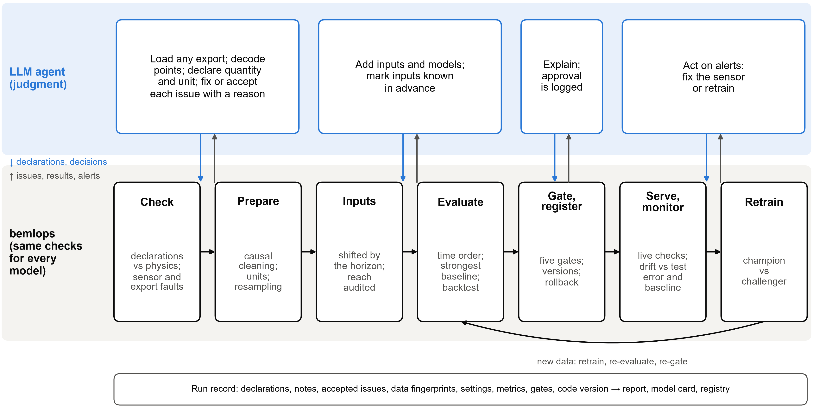

# Framework {#sec:framework}

This section describes version 0.3.1 (source fingerprint 84f7e16c74ac9fdc), which was frozen with a pre-specified analysis plan before any reported experiment was run; its history is listed in the Supplementary Material.

## Division of labor {#sec:division}

@fig:framework shows the division of labor (detailed in Supplementary Table S3). The agent may write any code it needs before handing the package a table with a time index; after that point, nothing reaches a model unless it has been declared, checked and prepared in a logged, deterministic way, and nothing reaches production unless it has passed explicit gates.

{#fig:framework width=100%}

## Declarations as the interface

The interface between the agent and the package is a declaration: for each column, a physical quantity and a unit, for example *zone_air_temperature [degF]*. Point names are ambiguous and vendor-specific, whereas a declaration is explicit and can be checked. Each of the 28 quantities (including a generic *other*) carries a canonical unit and its conversions, a plausible range, a narrower typical range from which the most likely unit is inferred when the declared one does not fit, and behavioral flags, for example that solar irradiance is zero at night and an idle meter may sit at zero. Two flags record knowledge that the package cannot infer: *flat_ok* marks sensors whose long flat stretches are normal, such as a CO~2~ sensor at its floor, and *known_ahead* marks values known at forecast time, such as schedules or weather forecasts. Only declared columns are used, and the quantity of the target fixes the task type (regression or, for binary quantities such as occupancy status, classification).

## Data checks and preparation

Errors found by the data check block fitting until the agent fixes the data or the declaration, or accepts the issue with a written reason; they include a unit that does not fit the values or changes part-way through a series, a cumulative meter declared as interval energy, decimal commas and an empty target. Warnings, such as stuck sensors, spikes, placeholder values, text entries, duplicates, out-of-order rows and gaps, are handled by a standard preparation step that logs every action.

Preparation sorts and de-duplicates the rows, converts units, sets text, placeholder values and impossible readings missing, masks stuck stretches and spikes, and resamples to a regular grid. Cleaning is causal: a spike is judged against the median of the four preceding readings, and a stretch of identical values is masked only from the point at which it is detectable (6 h by default). Interval totals are computed only from complete intervals, inputs are filled forward only, up to a limit, and the target is never filled.

## Inputs that cannot reach past the forecast time

For a forecast $h$ steps ahead, the prediction for interval $T$ uses measured data up to $T-h$ only; lags and rolling means are shifted accordingly, and only inputs declared *known_ahead* may be used at $T$. Every input records how far back it reaches, an audit refuses any input that reaches forward, and inputs correlated with the target above 0.995 are flagged as possible copies of it. In estimation mode ($h=0$), the target is estimated from other inputs at the same moment, as a virtual sensor or an M&V baseline.

## Evaluation {#sec:evaluation}

The data are split in time order into training, validation and test sets (70/15/15% by default), with a gap of $h$ steps between consecutive sets; there is no random split. Hyperparameters are tuned by random search with time-ordered cross-validation on the training set only. Every task includes baselines without machine learning. For numeric forecasts these are persistence, the value at the same time on the previous day and in the previous week, a time-of-day profile (separately for weekdays and weekends), a 168-h time-of-week profile, and, where an outdoor temperature is declared, a TOWT regression [@mathieu2011quantifying] with one level per time of week and a single piecewise-linear temperature term with the CalTRACK knots (30, 45, 55, 65, 75 and 90 °F), merging segments with fewer than 20 training hours; unlike the original, it does not fit separate temperature terms for occupied and unoccupied hours. The TOWT regression uses the temperature available at prediction time: the measured value for estimates and the value lagged by the horizon for forecasts, since no weather forecast is assumed. For numeric estimates the baselines are the training mean, the two profiles and TOWT; for binary targets they are persistence, the share of positive labels and a time-of-day probability profile. The strongest baseline on the validation set becomes the reference for the task. The candidates are ridge or logistic regression, a random forest, gradient boosting and, for regression, gradient boosting on the change from the latest value; the agent can add its own. The candidate or baseline with the lowest validation error is chosen, even when it is a baseline, and the chosen model and the reference are refitted on the training and validation data and scored once on the test set.

Accuracy is reported as skill against the reference, based on the root mean square error (RMSE),

$$ S = 1 - \frac{\mathrm{RMSE}_{\mathrm{model}}}{\mathrm{RMSE}_{\mathrm{ref}}} $$ {#eq:skill}

where RMSE is replaced by the Brier score [@brier1950] for binary targets. A skill of 0.05 on RMSE corresponds to a mean-square-error skill of about 0.10. For energy-like targets, the coefficient of variation of the RMSE, CV(RMSE), and the normalized mean bias error (NMBE) are computed on the test predictions aggregated to hours (hourly totals for energy and hourly means for power), for the model and for its reference baseline, and compared with the hourly limits of ASHRAE Guideline 14-2014 [@ashrae2014], 30% and ±10% (a 2023 edition has since been published). These limits are the guideline's hourly calibration criteria; they are used here as a familiar threshold, with $n-1$ in the denominators corresponding to $p = 1$ in the guideline's $n-p$:

$$ \mathrm{CV(RMSE)} = \frac{100}{|\bar{y}|} \sqrt{\frac{\sum_{t=1}^{n} e_t^2}{n-1}} \le 30\% $$ {#eq:cvrmse}

$$ \left|\mathrm{NMBE}\right| = \frac{100}{|\bar{y}|} \left| \frac{\sum_{t=1}^{n} e_t}{n-1} \right| \le 10\% $$ {#eq:nmbe}

where $e_t = y_t - \hat{y}_t$. Each run also reports a rolling-origin backtest over three blocks after training, refitting before each block; because it overlaps the validation period, it checks stability rather than testing independently. A 90% prediction interval $\hat{y}_t \pm q_{0.9}$ uses the 90th percentile of the absolute validation errors, in the manner of split conformal prediction; because its width is calibrated once, it does not adapt to changes in operation [@gibbs2021adaptive]. Grouped permutation importance shows which inputs the model relies on.

## Promotion gates, monitoring and retraining {#sec:gates}

A model reaches production only through a registry that evaluates five gates from the run record: every data error is resolved or accepted, the test skill is at least 0.05, the Guideline 14 limits are met where they apply, no input is flagged as a possible copy of the target or as reaching forward, and the test set has at least 200 rows. The Guideline 14 gate applies only to estimation-mode energy models, which are M&V baselines; for forecasts, which may use lags of the metered target, the limits are reported but not gated. The gates read the single test window, not the backtest. Overriding a gate requires a written reason and is logged; in the experiments, promotion followed the gates without a human step, whereas in operation the registry records the approval of the person responsible.

Every live prediction re-runs the data checks and rebuilds every trained input with the training code. A drift check on recent data recommends retraining when the recent primary error exceeds 1.5 times the error at test time, or when more than 20% of the recent values of an input fall outside its training range widened by 10% on each side; for forecasts it also scores persistence on the same rows and, when the model loses to it, recommends falling back to persistence and retraining; and it reports new sensor faults. Retraining reuses the production configuration on newer data, scores the champion and the challenger on rows that start after both training periods plus the horizon, and promotes the challenger only if it passes the gates and has the lower error.

@tbl:mlops maps the framework to the nine MLOps principles of Kreuzberger et al. [@kreuzberger2023]. A feature store is unnecessary because features are rebuilt from the declared configuration by the same code in training and serving, and an online endpoint because building forecasts are produced on a schedule. Reproducibility means re-executing the agent's frozen decisions with the same package version, not re-running the agent, which is not deterministic.

Table: MLOps principles [@kreuzberger2023] and their implementation in the framework. {#tbl:mlops}

| Principle | Implementation |
|:---|:---|
| P1 CI/CD automation | Tests, including end-to-end model tests, run on every commit; models are delivered through gated promotion |
| P2 Workflow orchestration | Train, retrain and reproduce pipelines, and a command-line interface with exit codes for any scheduler |
| P3 Reproducibility | Configuration, declarations, notes, seeds, library versions, code commit, package fingerprint and data fingerprints in every run record; reproduction checks that every metric matches |
| P4 Versioning | Code commit and package fingerprint; numbered model versions; data fingerprints |
| P5 Collaboration | Report and model card per run; decisions and accepted issues recorded with reasons |
| P6 Continuous training and evaluation | Champion–challenger retraining on rows that neither model has seen |
| P7 Metadata tracking | Run records and a registry event log |
| P8 Continuous monitoring | Live data validation, comparison of training and live inputs, drift and fault monitoring |
| P9 Feedback loops | Monitoring recommends retraining; data checks feed back to the agent |

## Implementation and agent instructions

bemlops is a Python package (BSD 3-Clause licence) built on pandas and scikit-learn (modules in Supplementary Table S4). A typical session declares the columns, checks and prepares the data, fits the run and registers the model in about a dozen lines of code. The evaluated version has 51 automated tests, including one that perturbs every value after the forecast time and checks that no input changes. Every run record carries the git commit of the case-study code and a fingerprint of the package source.

The agent learns the workflow from an Agent Skill [@zhang2025a], a short instruction file loaded on demand, with the workflow steps, seven rules (for example, never split building time series at random, and never change a declaration to silence a check), a playbook for messy data and a reference for decoding BAS point names. It succeeds the prompt template of the preliminary study: instead of prescribing code, it prescribes conduct.
