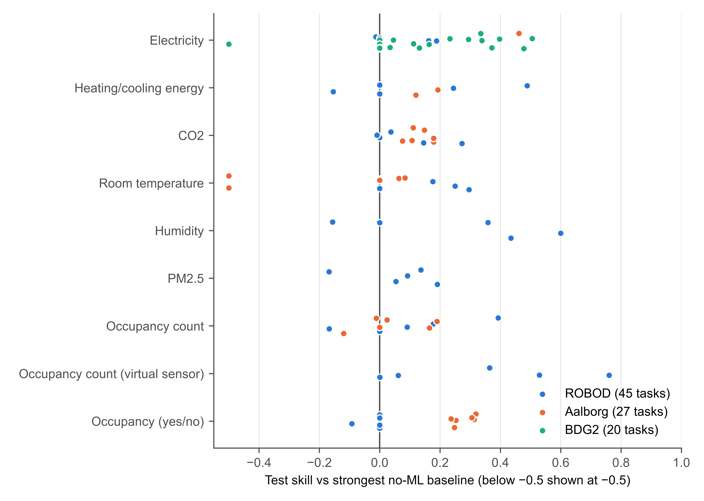
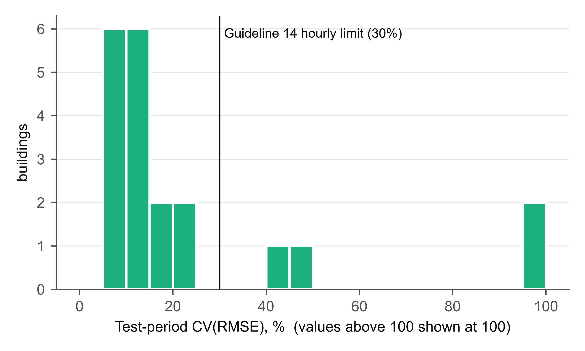
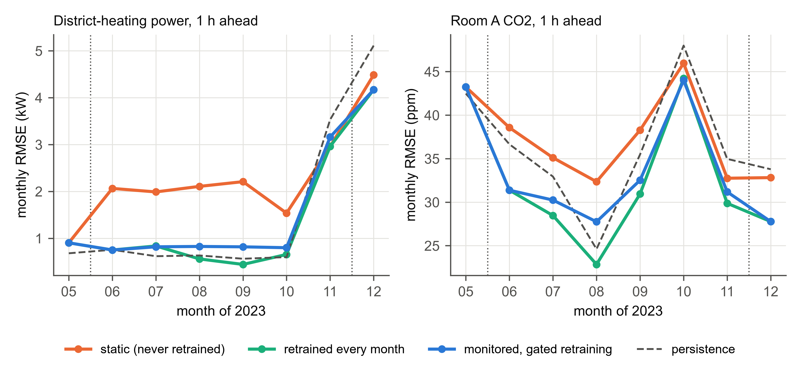

# Results {#sec:results}

## Evaluation protocol (RQ2) {#sec:res-protocol}

@tbl:protocol and @fig:protocol compare the three protocols on 22 regression tasks, 16 from ROBOD Rooms 4 and 5 and 6 from Aalborg Room A and its building systems. Blocked cross-validation gave a higher RMSE than shuffled cross-validation on every task. The median ratio was 1.36 (interquartile range 1.26–1.44; range 1.02–2.46), so the random split of the preliminary study would have understated the RMSE by a median of 27% (range 2–59%), and by more than 10% on 21 of the 22 tasks. The median coefficient of determination fell from 0.92 to 0.86. The largest gaps occurred for the virtual people counters, with ratios of 2.46 and 1.86, where inputs measured at the same moment make neighboring rows near-duplicates and R^2^ fell from 0.89 to 0.32 in Room 5, and for the Room 5 plug load (2.23) and the Aalborg ventilation power (1.94), which follow schedules. With shuffling, the neighbors of a test row a few minutes earlier and later are in the training set, so the model only has to interpolate between them. Standard cross-validation is valid for purely autoregressive models with uncorrelated errors [@bergmeir2018]; the gaps observed here arise because neighboring 5–15-min rows, and inputs measured at the same moment, are near-duplicates of each other. The smallest gap (1.02) occurred for a plug load that the model could hardly predict under either protocol (R^2^ of 0.13 and 0.10).

Table: The same random forest, inputs and rows evaluated with shuffled and blocked five-fold cross-validation. {#tbl:protocol}
<!-- table: j_protocol -->
Note: "Selection on all rows / shuffled": RMSE of shuffled cross-validation after feature selection on all rows, divided by that of shuffled cross-validation alone.

{#fig:protocol width=11cm}

Feature selection on all rows, the second step of the earlier recipe, added no measurable optimism. On these tasks it made shuffled cross-validation slightly less optimistic (median RMSE ratio to shuffled cross-validation alone 1.04; range 1.00–1.31), probably because dropping features removed information that the forest could otherwise interpolate from. Selection leakage remains a risk in principle [@kapoor2023], but here the random split did all the damage.

A single time-ordered holdout is not ground truth either. Compared with blocked cross-validation over the whole record, the framework's own test window gave a lower RMSE on some tasks and a higher RMSE on others (median ratio 0.90; range 0.30–2.38; Supplementary Material, Table S4). A single window can be unusually quiet, like June for Room B CO~2~ in the pilot, or unusually hard, like the start of the heating season for district heating. This is why the framework also reports a rolling-origin backtest and why deployed models need monitoring.

## Many targets and buildings (RQ1) {#sec:res-targets}

All 92 tasks ran through the full workflow to a fitted, evaluated and gated result, with no manual step beyond the declarations and notes in the case-study scripts. @tbl:bydataset summarizes the results by dataset, @tbl:bytarget by target type, and @fig:skill shows every task.

Table: Results by dataset. Percentages are given with 95% Wilson intervals; DM denotes a Diebold–Mariano test of the model against the strongest baseline on the test period (p < 0.05). {#tbl:bydataset}
<!-- table: j_datasets -->

Table: Results by target type across all datasets. {#tbl:bytarget}
<!-- table: j_targets -->
Note: "Skill > 0" and "Better (DM)" give numbers of tasks. Typical test errors are medians across tasks.

{#fig:skill width=16cm}

The median skill across the 92 tasks was 0.10 (interquartile range 0.00–0.25). The model had a lower test RMSE than the strongest baseline in 60 tasks (65%; 95% interval 55–74%), the difference was significant in 48 (52%; 42–62%), and the baseline was significantly better in 5. In 20 tasks a baseline had the lowest validation error and was kept, and 51 tasks (55%; 45–65%) passed all five promotion gates. With deliberately ordinary models and no weather forecasts, a model was therefore worth deploying in only about half of the tasks; in the remainder the framework recommended the simple rule.

The pattern follows the physics of each target. CO~2~ was the most consistently predictable target (skill above zero in 9 of 11 tasks, 8 of them significant), because its changes lag occupancy and ventilation, which the inputs measure. The virtual people counter, which estimates the current count from Wi-Fi, CO~2~, sound and plug loads, and the humidity forecasts both reached median skills of 0.36. Forecasts of the occupant count 30 min or 1 h ahead barely beat persistence (median 0.02), since who walks in next is not in the data, and room temperature, a slow and well-controlled variable, had a median skill of 0.06. The energy targets had median skills of 0.12. Of the 33 energy tasks, 23 met the Guideline 14 hourly criteria: all three building-level meters of the Aalborg building, 16 of the 20 BDG2 buildings, but only 4 of the 10 room-level meters of ROBOD. The six ROBOD failures are room-level chilled-water and plug-load meters with small, intermittent loads, for which CV(RMSE) is large whatever the model (218–511% on hourly values in the worst three).

By dataset, Aalborg had the highest share of models significantly better than the baseline (20 of 27) and ROBOD the lowest (17 of 45). The ROBOD rooms have 29–47 weekdays of data each, its lecture rooms are often empty, and in Room 1 the framework kept persistence for five of the nine tasks.

The rolling-origin backtest and the single test window disagreed in the sign of the skill in 7 of the 92 tasks. In the clearest case, temperature in Aalborg Room E, the test skill was −1.03 and the backtest skill +0.05. The test model, trained to mid-November, probably met a heating regime it had not seen, whereas the backtest refits before each of its blocks and had seen the start of the heating season by its last block. The gates follow the test window and refused the model; the two numbers together tell an operator more than either alone.

The nominal 90% intervals covered a median of 90–96% of the test values for the indoor-environment and occupancy targets. Coverage was poor wherever the test period differed from the validation period on which the intervals were calibrated: 26–28% for the Aalborg district heating (calibrated on October to mid-November and tested on mid-November to December), 47% for the Room E temperature, and 37% for the BDG2 building whose consumption collapsed (see below). Intervals of one global width calibrated on a single period are a weak point of the current version.

The dead chilled-water meter (@sec:design) changed the results in both directions. After the dead-meter days were set to missing, the Room 3 task changed from persistence being kept (skill 0) to a model with skill 0.49 that passed all gates, because the false zeros had made the series unpredictable. The Room 5 task changed the other way, from a skill of 0.60 to 0.00, with the time-of-day profile kept: the false zeros had pulled the profile baseline down, so the model had looked far better than it was. Room 4, with one dead day, hardly changed (0.25 to 0.24). A fault that a single-column check cannot see can thus either inflate or hide the value of a model.

The BDG2 study applied one configuration, decided once by the agent, to 20 buildings at 16 sites used for education, offices, lodging, public services and other purposes (@tbl:bdg2, @fig:bdg2). Every building was fitted with no manual step, in a median of 77 s on a laptop. In five buildings a baseline won on validation (persistence in two and the time-of-day profile in three) and the framework kept it; in three more the model beat the baseline by less than the skill of 0.05 required for promotion. A pipeline that always reports its best model would have deployed all eight. The gates also caught a broken test period: at one education building (Rat_education_Colin), consumption in the test period fell far below anything seen in training (NMBE of −110%), the model's error was about six times the baseline's (skill −5.15), and the gates refused it. The data check had found nothing wrong with the individual readings; what had changed was the building.

Table: Day-ahead hourly electricity forecasts for 20 BDG2 buildings with one configuration. {#tbl:bdg2}
<!-- table: j_bdg2 -->

{#fig:bdg2 width=11cm}

## Planted faults (RQ3) {#sec:res-faults}

@tbl:detection shows how often each planted fault was detected over ten seeds on real Aalborg data. Six of the eight fault types were detected in every seed, with the unit change always reported as a blocking error, and spikes were detected in nine seeds of ten. The three-day stuck ventilation meter was detected in five of ten: when its frozen value lies at the meter's night-time floor, a stuck meter looks the same as equipment that is switched off. This is the price of the rule that stops idle equipment, and solar irradiance at night, from being flagged as stuck. The detection rates are optimistic in one respect, because several detectors were revised on this dataset.

Table: Detection of planted faults in the Aalborg Room A data over ten seeds. A fault counts as detected when the check reports a new issue of that type on that column. {#tbl:detection}
<!-- table: fault_detection -->

@tbl:faultcost compares the same random forest trained in four ways. Trained on faulty data with the framework, after the unit fix had resolved its one blocking error, the model reproduced the clean-data result in every seed, with a mean absolute error (MAE) of 19.8 ± 0.2 ppm against 19.9 ± 0.3 ppm on clean data. Trained by the quick script, the same model had an MAE of 21.6 ± 1.7 ppm, 9% higher on average and 1.9 ppm worse in the median paired seed (Wilcoxon p = 0.01). Giving the script the same unit fix changed almost nothing (21.6 ± 1.8 ppm; 1.6 ppm worse than the framework; p = 0.01). The gain therefore came from the framework's standard handling of the other faults (masking placeholder values, text, spikes and stuck stretches, and not filling the outage), not from the one decision left to the agent. The unit fix mattered little here, probably because room temperature carries little information about CO~2~ an hour ahead.

Table: The same random forest with the same inputs, scored against the clean CO~2~ target over the same test period (ten seeds). Differences are paired by seed (positive: framework better), with Wilcoxon signed-rank p-values. {#tbl:faultcost}
<!-- table: j_faults -->

The effect did not appear in RMSE. All three faulty-data arms averaged 34.4–34.5 ppm, against 34.8 ppm on clean data, and the paired differences were not significant (p ≥ 0.92). The RMSE here is dominated by large errors when occupants arrive or leave, which no arm predicts, whereas the planted placeholders probably bias many ordinary predictions by a few ppm: they corrupt a few training targets, which pull down the averages in the leaves of the trees. What did change was the spread of the RMSE between seeds: ±1.3 ppm for the quick script against ±0.3 ppm with the framework and ±0.4 ppm from the random seed alone on clean data. In short, the framework made the result on faulty data match the result on clean data, and on this task the difference from a quick script is small in absolute terms.

## Deployment, monitoring and retraining over eight months (RQ4) {#sec:res-lifecycle}

Both lifecycle tasks started from a model trained on late February to April 2023, during the heating season, and promoted after it passed the gates. @tbl:lifecycle gives the mean monthly RMSE of every arm from May to December, @fig:lifecycle shows the trajectories, and the monthly values are listed in the Supplementary Material (Tables S5 and S6).

Table: Mean monthly RMSE from May to December 2023 for the lifecycle arms. {#tbl:lifecycle}
<!-- table: j_lifecycle -->

{#fig:lifecycle width=16cm}

For district heating, the drift check recommended retraining in May, November and December, and each challenger was promoted; the December challenger would have served from January, after the experiment ended. In May the error was 1.9 times its test-time level and several inputs were outside their training range, and the challenger trained on data to the end of May beat the champion on rows that neither had seen (RMSE 0.58 against 1.01 kW). In November, with the heating back on, the model trained to the end of May drifted to 5.4 times its test-time error and was replaced at the end of the month. Monitoring with gated retraining reduced the mean monthly RMSE from 2.28 kW (static) to 1.53 kW, a reduction of 33%. It matched persistence on the mean (1.56 kW) but lost to it in five of the eight months, all between May and October: with the heating off, the load barely changes, so the value an hour earlier is nearly perfect, and the drift check compared the model only with its own test-time error, not with persistence, so it never flagged this. Retraining every month without gates performed best, at 1.41 kW. The drift check did not recommend retraining once between June and October, because the drift ratio stayed at 1.29–1.44, below its threshold of 1.5, throughout the slow loss of skill over the summer. The fallback rule added after this experiment would have given 1.50 kW.

For Room A CO~2~, retraining was triggered in May and November by inputs moving outside their training range, before the accuracy had degraded, and both challengers were promoted. The December challenger lost to the champion on unseen rows (29.5 against 28.7 ppm) and was not promoted, as designed. The production model averaged 33.5 ppm, 10% lower than the static model (37.4 ppm) and below persistence (36.1 ppm), which it beat in six of the eight months. Monthly retraining reached 32.3 ppm. The fallback rule would have made the CO~2~ forecasts worse (34.5 ppm), because a month lost to persistence was followed by a month won.

Monitoring with gated retraining therefore clearly beat a model left alone. For district heating it only matched persistence on the mean, and it did worse than simple monthly retraining on both tasks. With clean data, how often a model was retrained mattered more than the gates; the gates exist for the months in which a fault or an unusual period would otherwise be trained into production, and two clean trajectories contain too few such months to show their value.

## Independent agents with and without the framework (RQ5) {#sec:res-pilot}

All eight deliverables ran on the hidden data and passed the leakage test: no forecast changed when every later value was perturbed (@tbl:pilot). For T1 (Room B CO~2~, June hidden), no agent beat persistence by a meaningful margin, with skills from −0.04 to 0.06. June was quiet: the persistence RMSE was 21 ppm, against 29–48 ppm in the spring blocks on which the agents had validated. Against the time-of-day profile, every agent had a skill of 0.71–0.73, because CO~2~ depends more on who is in the room than on the hour. For T2 (chilled-water energy), all agents reached a skill of 0.75–0.76 against persistence and 0.16–0.21 against the time-of-day profile, the stronger baseline for this scheduled load. That profile was computed from the training period without the dead-meter days; with those days included, the profile is much weaker and the skill would have appeared to be 0.65–0.67, the same distortion as in the Room 5 case study.

Table: Pilot results on the hidden periods. {#tbl:pilot}
<!-- table: j_pilot -->

Within each task and model, the framework made no consistent difference to accuracy. For T1 with Opus, the framework run was better by 1.45 ppm (95% day-block bootstrap interval −2.50 to −0.32 ppm), whereas for T1 with Sonnet it was worse by 1.80 ppm (0.80 to 2.80 ppm); for T2 both differences were within 0.04 kWh, and both intervals included zero. With one run per cell, these signs reflect run-to-run variation as much as the arm. Every agent overestimated its own error, with ratios of achieved to self-reported RMSE of 0.59–0.82; the agents were cautious rather than optimistic.

@tbl:audit summarizes the manual audit. The agents found 7 or 8 of the 8 planted faults with or without the framework (29 of 32 with it and 30 of 32 without), and all T1 agents missed the three-day stuck ventilation meter, an input that none of them used. Every T2 agent found the dead chilled-water meter, which had not been planted, as well as catch-up readings after communication losses; the framework's checks flagged neither. Seven of the eight agents wrote their own test that forecasts do not use later data, including all four framework agents, although the framework already audits its own inputs.

Table: What each agent found and built, and what it cost (manual audit of code and reports; usage counters of the agent runs). {#tbl:audit}
<!-- table: j_pilot_audit -->

Two of the four framework agents, both Sonnet, used its checks but replaced its model with their own; one of them turned off the framework's masking, judging it to look ahead, which it did in that earlier version. The other two, both Opus, kept a framework model but had to adapt it: the T1 agent made it predict the change from the latest value and moved the split so that training covered a new ventilation schedule, and the T2 agent added its own schedule and holiday inputs. All four gave the same reasons: they could not add their own inputs or models, there was no model of the change from the latest value, there was only one test window, and persistence was the only reference for a scheduled load. Their reports and the defects they found led to the changes listed in Supplementary Table S1, which were made before E1–E4 were run; the framework arm of the pilot therefore used an earlier package version (git commit *5c575a6*) than the case studies. The framework arm used more tokens than the agent-alone arm in all four pairs (5–52% more) and more tool calls in all four (32–89% more), and took longer in three of the four. How much of this came from the usability report that only the framework arm was asked for, from reading the skill, or from working around the defects of the earlier version cannot be separated.
