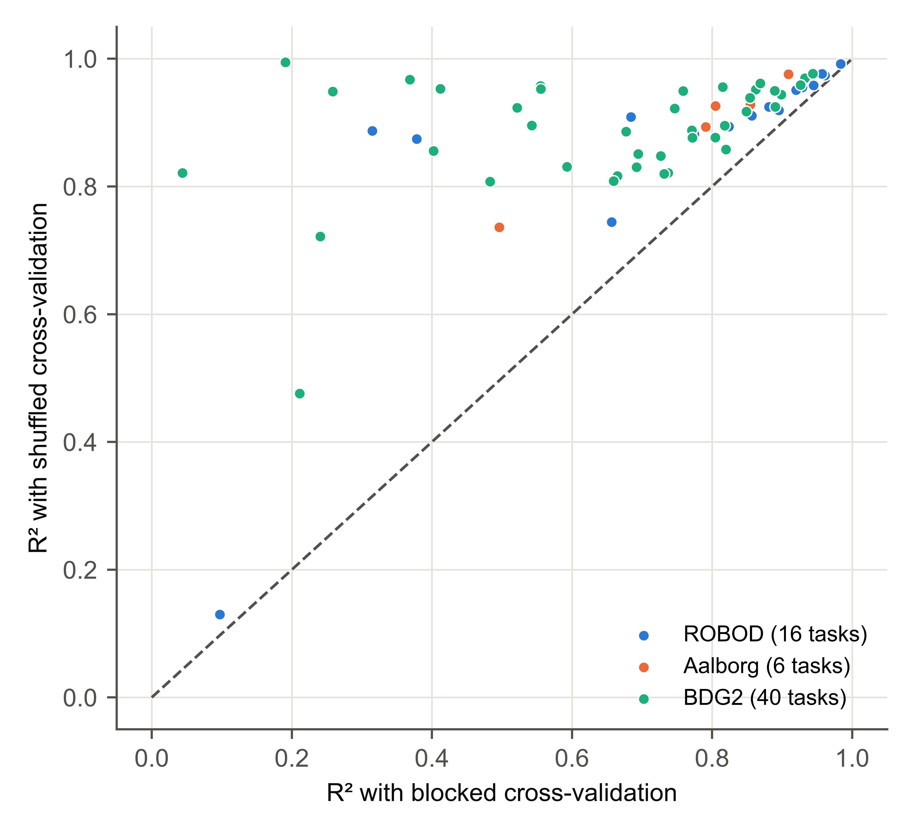
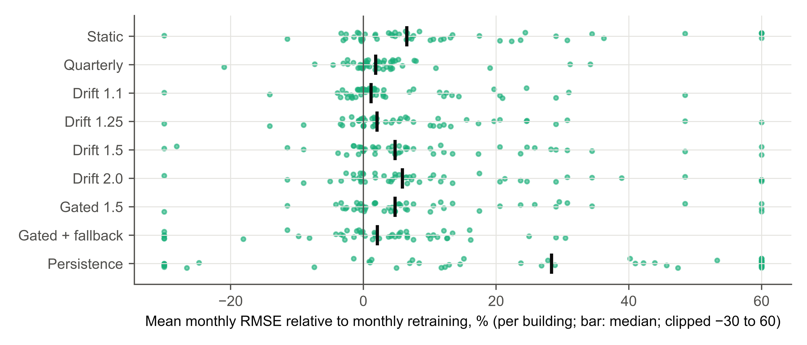

# Results {#sec:results}

## Portfolio and many targets (RQ1) {#sec:res-targets}

All 272 tasks ran through the full workflow to an evaluated and gated result with no manual step beyond the declarations in the case-study scripts (@tbl:e1; every task in Supplementary Table S12).

Table: Results of the 272 tasks by dataset. {#tbl:e1}
<!-- table: v3_e1 -->
Note: Skill is defined on RMSE (Brier score for binary targets) against the strongest baseline on validation; a kept baseline has skill 0. "Better than baseline (DM)": share of tasks in which the model was better than its reference in a Diebold–Mariano test (p < 0.05), with 95% cluster-bootstrap intervals over buildings, rooms and building systems. "Machine-learning model refused by gates": machine-learning models that won on validation but failed a promotion gate.

Across the 200 BDG2 buildings, a routinely configured model was significantly better than the strongest baseline in 131 (66%; 95% interval 59–72%), with a median skill of 0.16 (interquartile range 0.03–0.28). The references were strong and varied: persistence in 59 buildings, the value a week earlier in 54, TOWT in 51, a time-of-week or time-of-day profile in 32 and the value a day earlier in 4. In 40 buildings a baseline won on validation and was kept, and 18 of the 160 machine-learning models that won on validation failed a promotion gate, so 142 buildings (71%) received a promoted model. The models met the hourly Guideline 14 limits in 159 buildings and their references in 150 (@fig:bdg2), so the limits separate predictable meters from difficult ones more than good models from poor ones.

{#fig:bdg2 width=11cm}

The room and system tasks show how much this depends on the target (@tbl:targets, @fig:skill). Models were significantly better in 20 of the 27 Aalborg tasks (74%; 61–88%) but in only 19 of the 45 ROBOD tasks (42%; 24–62%), whose test windows covered only 3–8 weekdays. CO~2~ was consistently predictable (8 of 11 tasks; median skill 0.11), because it lags occupancy and ventilation, which the inputs measure, and so was the current people count estimated from Wi-Fi, CO~2~, sound and plug loads (median skill 0.42). Occupant counts 30 min or 1 h ahead barely beat persistence (median skill 0.00), and well-controlled room temperature reached 0.06. Among the room and system energy targets, plug loads were the hardest (1 of 5 significant), and heating and cooling energy reached a median skill of 0.12.

Table: Results by target. {#tbl:targets}
<!-- table: v3_targets -->
Note: "Better (DM)" and "Promoted" give numbers of tasks. Coverage: share of test values inside the 90% interval.

{#fig:skill width=16cm}

Over all 272 tasks, the model was significantly better than its reference in 170 (62.5%; 56–69%); the small-sample correction and the Benjamini–Hochberg correction changed this to 169 and 168. A baseline was kept in 56 tasks and 31 of the 216 machine-learning models that won on validation were refused, so 185 tasks (68%) received a promoted model and 87 (32%) kept the simple rule. Stricter gates, requiring a significant DM result, a positive lower bootstrap bound, a skill of at least 0.10 or seven test days, would have promoted 167–173 models (Supplementary Table S13). The nominal 90% intervals covered a median of 81–96% of the test values per target type.

The data checks found faults in the BDG2 meters although the dataset authors had cleaned them (Supplementary Table S11). Stuck stretches were masked in 88 of the 200 meters, typically a small share of the readings (median 0.95%), and two faults affected whole sites. At one site (Gator, 14 sampled buildings), every meter changes value only at midnight: the hourly readings are daily totals spread evenly over the day. The stuck check flagged all 14 meters and masked 70–74% of their readings; an hourly forecast is not meaningful for these meters, and 12 of the 14 received no promoted model. At another site (Lamb, 14 buildings), the meters read zero or close to it for a total of 7 weeks to 10.5 months of 2017. The checks did not flag this, because zero is a valid reading for a meter whose equipment is off. In 10 of these buildings the stretch fell in the test window; the framework kept persistence or refused the model in 9, but promoted one model whose test window was mostly dead readings. In an exploratory sensitivity analysis that leaves out the 24 buildings with either fault, a model was significantly better in 73% of the remaining 176 buildings (67–80%), with a median skill of 0.18.

In an exploratory analysis, the forecasts were also scored on each day's peak hourly demand, which matters for demand response. For the 157 buildings in which a model won on validation, the mean absolute error of the forecast daily peak was a median of 9.6% of the actual peak for the model and 12.1% for its reference, and the model was better in 137.

## Measurement and verification pseudo-savings (RQ2) {#sec:res-mv}

Of the 200 buildings, 152 at 12 sites had at least 90% of hourly readings in both years. In 17, the 2017 mean load differed from the 2016 mean by more than 30%, a likely non-routine change; 8 of these are Lamb buildings with months of zero readings (@tbl:mv, @fig:mv).

Table: Annual pseudo-savings error in 2017 of baselines fitted on 2016, with no efficiency measure installed. {#tbl:mv}
<!-- table: v3_mv -->
Note: Pseudo-savings error: predicted minus metered 2017 consumption, divided by metered consumption; the true savings are zero. CV(RMSE) and the 30%/±10% limits on hourly values of 2017.

Fitted on 2016, the TOWT regression had a median absolute pseudo-savings error of 5.2% over the 152 buildings and of 4.5% (interquartile range 2.3–9.7%) over the 135 without a flagged change, and it was within ±10% in 103 of those 135. The errors were biased: the median signed error was +3.6%, so TOWT would have reported savings of a few percent that no measure produced; whether this reflects gradual operational changes or model error cannot be separated with these data. The framework chose TOWT itself in 51 buildings, gradient boosting in 48, a profile in 49 and ridge regression or the training mean in 4. Its median absolute error was 5.3%, the same as that of TOWT (paired Wilcoxon p = 0.97; lower in 71 buildings, higher in 81), and the median hourly CV(RMSE) in 2017 was 20.9% for both: for annual savings, the machine-learning candidates added nothing over the M&V standard.

A machine-learning model passed all gates, which in estimation mode include the Guideline 14 limits, in only 25 of the 152 buildings; in 101 a baseline had been chosen on validation. In those 25 buildings the median absolute pseudo-savings error was 3.7%, against 5.7% in the others: the gates picked out buildings whose baseline could be trusted.

{#fig:mv width=13cm}

The evaluation protocol changed the M&V decision (@tbl:mvprotocol, @fig:mvestimate). Every estimate of the error of TOWT made from the 2016 data understated the error realized in 2017, the time-ordered split least (median ratio of estimated to realized CV(RMSE) 0.97). Shuffled cross-validation would have accepted 120 baselines as meeting the hourly limits, 32 of which then missed them in 2017; the time-ordered split would have accepted 88, of which 13 missed.

Table: Error of the TOWT baseline estimated from the 2016 data in four ways, against the error realized in 2017 (152 buildings). {#tbl:mvprotocol}
<!-- table: v3_mv_protocol -->
Note: "Estimate meets limits": hourly CV(RMSE) ≤ 30% and |NMBE| ≤ 10% as estimated from 2016; "…but 2017 does not": of those, the buildings whose 2017 values miss the limits.

{#fig:mvestimate width=11cm}

## Evaluation protocol (RQ3) {#sec:res-protocol}

@tbl:protocol and @fig:protocol compare the protocols on 62 tasks: 16 from ROBOD, 6 from Aalborg and 40 BDG2 buildings. On the same rows, forward chaining gave a higher RMSE than shuffled cross-validation in every task, with a median ratio of 1.69 (95% interval 1.53–1.78; 1.75 for BDG2), so the random split of the preliminary study understated the error of a model used forward in time by a median of 41% (range 6–92%). Blocked cross-validation, which still trains on data after each test block, gave a median ratio of 1.42, and the median R^2^ fell from 0.92 with shuffling to 0.77 with blocking. The ratio was largest where neighboring rows are near-duplicates, as at the Gator buildings whose hourly readings are daily totals (3.8–5.5), and at a building whose consumption changed level (12.2). Feature selection on all rows, the other step of the earlier recipe, added no measurable optimism: it gave the same RMSE as selection inside each fold (ratios 0.995–1.003), so the random split did all the damage.

Table: The same random forest, inputs and rows evaluated with shuffled, blocked and forward-chaining cross-validation. {#tbl:protocol}
<!-- table: v3_protocol -->
Note: Ratios of RMSE, per task. Intervals: cluster bootstrap over rooms, systems and buildings, given only where there are at least five clusters; otherwise the range. Forward chaining and shuffled cross-validation are compared on the rows of blocked folds 2–5.

{#fig:protocol width=11cm}

For the 40 BDG2 buildings, the protocol also changed verdicts. On the same rows, the median hourly CV(RMSE) was 8.7% with shuffling, 13.8% with blocked cross-validation and 15.9% with forward chaining, and shuffled cross-validation would have placed 37 models within the hourly Guideline 14 limits, 8 of which forward chaining did not confirm (Supplementary Table S14). With the M&V result of @sec:res-mv, this shows that the protocol changes decisions, not only error estimates.

## Retraining over a year of operation and the gate audit (RQ4) {#sec:res-lifecycle}

For 50 BDG2 buildings at 12 sites, retraining every month on all earlier data gave the lowest error over 2017 in most buildings (@tbl:lifecycle, @fig:lifecycle). Relative to it, the median building's mean monthly RMSE was 6.5% higher for the static model (95% interval 4.2–11.1%; higher in 37 of 50 buildings), 1.8% higher for quarterly retraining and 28% higher for persistence, which nevertheless beat the monthly retrained model in 10 buildings. The pooled RMSE over 2017 ranked the policies in nearly the same order.

Table: Mean monthly RMSE of each retraining policy relative to monthly retraining, over 2017 for 50 BDG2 buildings. {#tbl:lifecycle}
<!-- table: v3_lifecycle -->
Note: Intervals from a bootstrap over buildings. "Retrains advised (promoted)": median per building; for the gated policy, a retrain is promoted only if the challenger passes the gates and beats the champion on rows neither has seen.

{#fig:lifecycle width=16cm}

Drift-triggered retraining was only as good as its tolerance. At the default of 1.5, the error-ratio and input-range triggers advised 48 retrains in 50 building-years (a median of none per building), and the median building's error was 4.8% higher than with monthly retraining. Lowering the tolerance to 1.25 and 1.1 raised the retrains to 84 and 126 and brought the error to within 2.0% and 1.1% of monthly retraining. Gated retraining at 1.5 advised 76 retrains and promoted 18, with the same error as ungated retraining at 1.5. Serving persistence in the month after the model lost to it reduced the gap to 2.1%.

The gate audit tested whether the gates' decisions were borne out over the following three months (@tbl:audit). Of the models the gates promoted, 86% realized a skill of at least 0.05 against their own reference and 8% were worse than it; of those they refused, all for a test skill below 0.05, 54% then realized a skill of at least 0.05. Test and realized skill were moderately correlated (Spearman's ρ = 0.54). The gates were thus reliable when they promoted and conservative when they refused, the price of a threshold applied to one test window.

Table: Gate audit: the gate decision of each monthly machine-learning model against its realized skill over the following three months (496 models, 50 BDG2 buildings). {#tbl:audit}
<!-- table: v3_gate_audit -->
Note: Of the 600 monthly models, 96 were baselines kept on validation and 8 machine-learning models could not be scored on the following three months; both are excluded.

The Aalborg case was repeated on the frozen version, whose drift check also compares the model with persistence (Supplementary Tables S8–S10). For district heating, the check recommended retraining in July because the model had lost to persistence, although its error ratio (1.42) was below the tolerance; the gated model's mean monthly RMSE was 1.38 kW, 40% below the static model (2.28 kW) and below persistence (1.56 kW), which it beat in six of eight months. In the earlier version, without that comparison, the gated model had lost to persistence in five of the eight months. Monthly retraining reached 1.41 kW. For Room A CO~2~, the gated model averaged 33.1 ppm, 12% below the static model (37.4 ppm) and below persistence (36.1 ppm), and monthly retraining reached 32.3 ppm.

## Data faults (RQ5) {#sec:res-faults}

Six of the eight planted fault types were detected in every seed, the unit change always as a blocking error, spikes in 9 seeds of 10, and the three-day stuck ventilation meter in 5 (@tbl:detection): when its frozen value lies at the meter's night-time floor, a stuck meter looks like equipment that is switched off. These rates are optimistic, because several detectors were revised on this dataset.

Table: Detection of planted faults in the Aalborg Room A data over ten seeds. A fault counts as detected when the check reports a new issue of that type on that column. {#tbl:detection}
<!-- table: v3_fault_detection -->

@tbl:faultcost compares the same random forest prepared in six ways. On faulty data, the framework, after the unit fix had resolved its one blocking error, had a lower mean absolute error (MAE) than the quick script, with or without the same unit fix (median paired difference 1.9 ppm; Wilcoxon p = 0.01). The RMSE did not differ, but it varied between seeds about five times more for the quick script. The competent script matched the framework in MAE (p = 0.56) and was 0.5 ppm better in RMSE (p = 0.004). On clean data, too, the quick script had a lower RMSE than the framework's preparation (33.8 against 34.8 ppm). The framework masks whatever its checks flag, and in this record they flagged hundreds of CO~2~ readings, such as 702 ppm, as single-sample spikes that are plausibly real rises when people enter, so some of this cost is likely due to false alarms. The framework's default handling thus reproduced a competent script and avoided the larger, seed-dependent errors of a quick script, at a small cost in RMSE.

Table: The same random forest with the same inputs, forecasting CO~2~ 1 h ahead and scored against the clean target over the same test period (mean ± standard deviation over ten seeds). Differences are paired by seed against the framework on faulty data (positive: framework better), with Wilcoxon signed-rank p-values. {#tbl:faultcost}
<!-- table: v3_fault_cost -->

On the untouched data, the checks raised 120 distinct warnings on the BDG2 meters and weather stations, 41 on ROBOD and 21 on Aalborg, mostly stuck stretches and spikes (Supplementary Table S11); some were real faults, such as the daily-total meters, and some were not, such as the CO~2~ spikes above.
